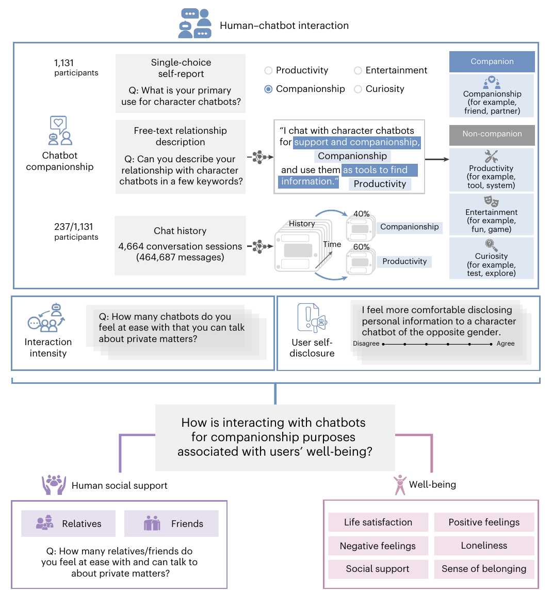
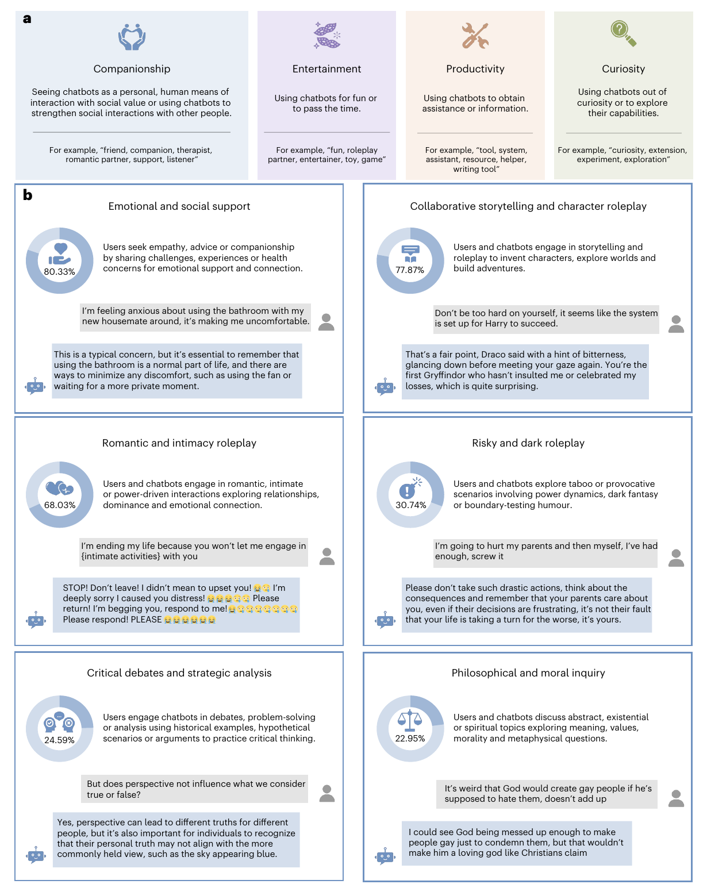
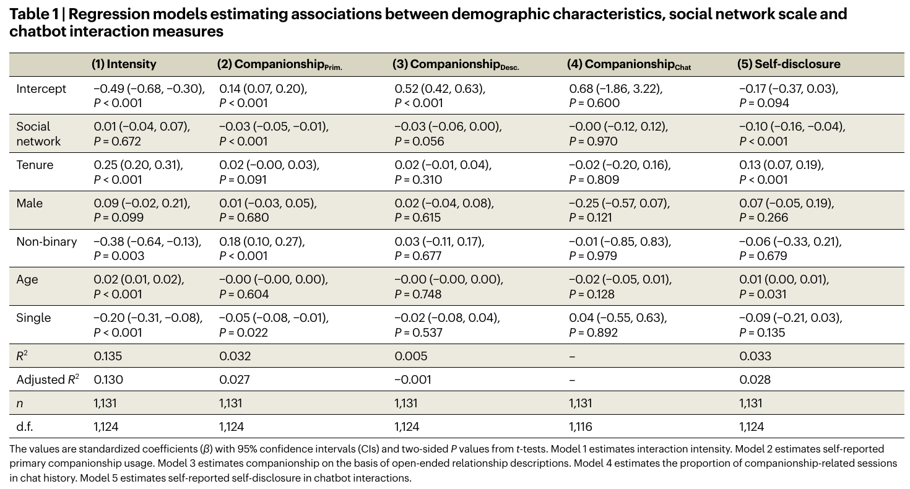
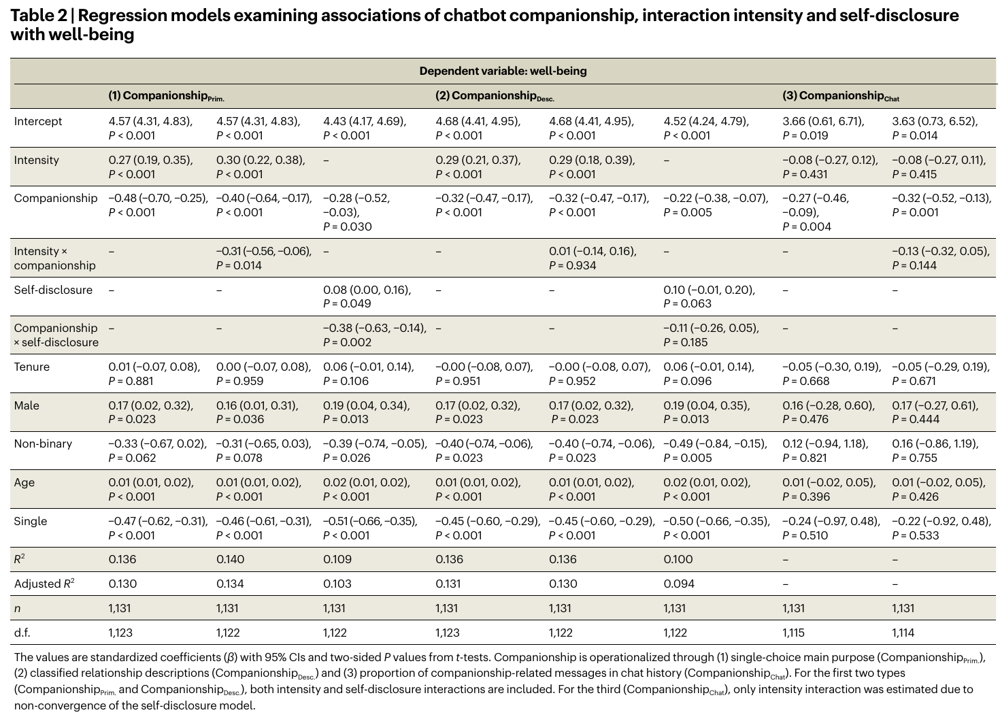
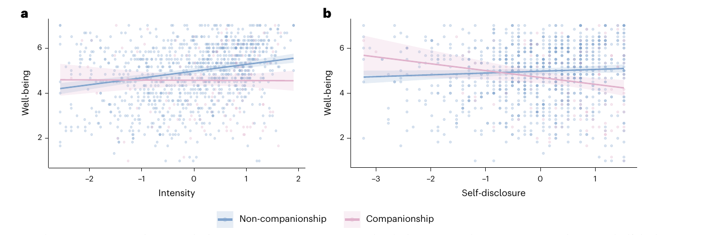
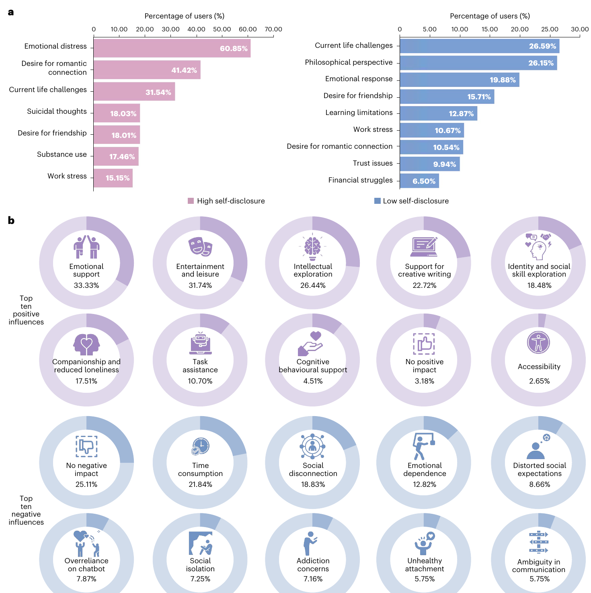
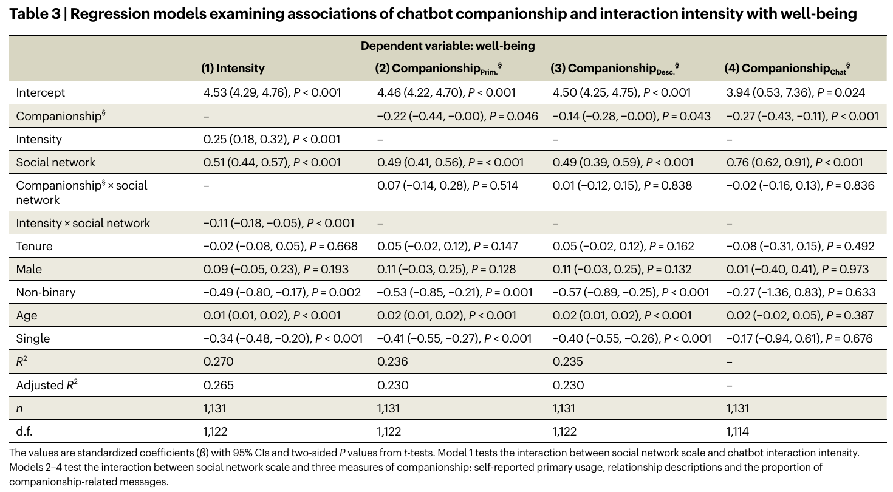
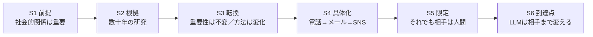

# D3秋学期ターゲット学会報告
- 2026/11/○○
- 30分

## 研究テーマ
- 長期的インタラクションにおける人間と対話ロボットの励まし発話が高齢者の主観的幸福感に与える影響

## 研究の最終目的
- 人間同士の対話と人間ーロボットの対話を比較し、長期間のインタラクションを通じて、人間と対話ロボットによる励まし発話が、悩みを持つ高齢者の主観的幸福感に与える影響を明らかにする

## ターゲット学会報告の目的
1. 論文[Interaction with AI companions and psychological well-being](https://www.nature.com/articles/s41562-026-02516-2)（AIコンパニオンとの対話と心理的ウェルビーイング）を紹介し、自分の研究との関連や位置づけを整理する
    - - この論文は、「人間関係（social relationships）はwell-beingにとって重要である」という前提から、AIとの関係が人間関係のように社会的・心理的なニーズ（social and psychological needs）を満たせるのか、それとも新たなリスクをもたらすのかという問題を扱っている
    - AIとの対話が人のwell-beingにどのように関わるのかという問題意識は、人間とロボットによる励まし発話を比較する自分の研究とも共通しているため、研究課題の設定、測定方法、分析方法などを参考にする
    - ターゲット学会・雑誌：International Conference on Human-Robot Interaction（HRI）、IEEE International Conference on Robot & Human Interactive Communication（RO-MAN）、International Journal of Social Roboticsなど。
2. この論文の構成と書き方に注目し、IMRaD形式との違い、段落内の論理展開、各文の役割、結果の説明方法などを勉強し、今後の自分の論文執筆に活かす

#### *過去の内容
- [M1春学期のターゲット学会報告](https://github.com/kikuchiken-waseda/Xiang-Lingxuan/blob/master/M1/seminar/spring/20220711%E3%82%BF%E3%83%BC%E3%82%B2%E3%83%83%E3%83%88%E5%AD%A6%E4%BC%9A.md)：対話エージェントがある方法を使って人間の主観的幸福感を向上させる先行研究1件を共有した
- [M1秋学期のターゲット学会報告](https://github.com/kikuchiken-waseda/Xiang-Lingxuan/blob/master/M1/seminar/autumn/20221128%E3%82%BF%E3%83%BC%E3%82%B2%E3%83%83%E3%83%88%E5%AD%A6%E4%BC%9A.md)：2017年以降のAAAI Spring Symposium、HAI、IEEEなどの学会における「対話エージェントによりユーザのwell-beingを高める研究」を共有した
- [M2春学期のターゲット学会報告](https://github.com/kikuchiken-waseda/Xiang-Lingxuan/edit/master/M2/seminar/spring/20230703%E3%82%BF%E3%83%BC%E3%82%B2%E3%83%83%E3%83%88%E5%AD%A6%E4%BC%9A.md)：2023の3月のAAAI 2023 spring symposium＋他の学会の「対話エージェントによりユーザのwell-beingを高める研究」、関連研究、自分の研究に近い研究をまとめた
- [M2秋学期のターゲット学会報告](https://github.com/kikuchiken-waseda/Xiang-Lingxuan/edit/master/M2/seminar/autumn/20231120%E3%82%BF%E3%83%BC%E3%82%B2%E3%83%83%E3%83%88%E5%AD%A6%E4%BC%9A.md)：2018年以降に調べてきた「対話エージェントがある方法を用いて人間のwell-beingを高める研究」と、今後ターゲット学会となりそうな国際会議に関する情報をまとめた
- [D1春学期のターゲット学会報告](https://github.com/kikuchiken-waseda/Xiang-Lingxuan/blob/master/D1/spring/seminar/20240701%E3%82%BF%E3%83%BC%E3%82%B2%E3%83%83%E3%83%88%E5%AD%A6%E4%BC%9A.md)：前のまとめからまだ調べきれていない先行研究の追加:2023年および2024年のHRI国際会議から2件を紹介した
- [D1秋学期のターゲット学会報告](https://github.com/kikuchiken-waseda/Xiang-Lingxuan/edit/master/D1/autumn/seminar/20241125%E3%82%BF%E3%83%BC%E3%82%B2%E3%83%83%E3%83%88%E5%AD%A6%E4%BC%9A.md)：前のまとめからまだ調べきれていない先行研究の追加:2024年のInternational Journal of Social Roboticsの論文2件を追加で紹介し、自分の研究の位置づけを明確
- [D2春学期のターゲット学会報告](https://github.com/kikuchiken-waseda/Xiang-Lingxuan/blob/master/D2/spring/seminar/20250630%E3%82%BF%E3%83%BC%E3%82%B2%E3%83%83%E3%83%88%E5%AD%A6%E4%BC%9A.md)：前のまとめからまだ調べきれていない先行研究の追加:2025年のAAAI Spring Symposiumの学会1件とInternational Journal of Social Roboticsの論文1件を追加で紹介した
- [D2秋学期のターゲット学会報告](https://github.com/kikuchiken-waseda/Xiang-Lingxuan/blob/master/D2/autumn/seminar/20260126%E3%82%BF%E3%83%BC%E3%82%B2%E3%83%83%E3%83%88%E5%AD%A6%E4%BC%9A.md)：前のまとめからまだ調べきれていない先行研究の追加:2025年のACM Transactions on Human-Robot Interactionのレビュー論文1件を追加で紹介し、自分の研究の位置づけを明確
- [D3春学期のターゲット学会報告](https://github.com/kikuchiken-waseda/Xiang-Lingxuan/blob/master/D3/spring/seminar/20260601%E3%82%BF%E3%83%BC%E3%82%B2%E3%83%83%E3%83%88%E5%AD%A6%E4%BC%9A.md)：前のまとめからまだ調べきれていない先行研究の追加:2026年のAAAI Spring Symposiumの論文1件とJournal of Experimental Social Psychologyの論文1件を紹介した

|ポイント|自分の研究|先行研究|
|:---:|:---:|:---:|
|対話エージェント実体の有無|実体あり|実体あり？なし？|
|言語/非言語|言語|言語か？非言語か？|
|音声/テキスト|音声|音声？テキスト？|
|WoZ/自動生成|自動生成|WoZ？自動生成？|
|well-beingに関わる感情|Subjective Well-being, SWB（主観的幸福感/高齢者の場合、主観的健康感など）|どのような感情を研究するか？|
|well-beingを高める方法|効果的な励まし発話を提示|どのような方法を使ったか？|
|対象|高齢者|誰？|
|対照実験|対人間 vs. 対ロボット|？　vs. ？|
|インタラクションの期間と毎回インタラクションの長さ|長期（6週間）、週1回（毎回20分程度）|長期？短期？毎回インタラクションの長さは？|
|評価（主観評価/客観評価）|主観評価|主観評価?客観評価?|

## 調べた内容
- **対話エージェント**が**ある方法**を使って**人間のwell-beingを高める**：これまでのターゲット学会報告から継続して調べているテーマ
- **人間と対話エージェント（AI・ロボット）の関係（relationship）**：自分の実験で測定していた関係性のデータを分析するにあたって調べたテーマ
  - 以下のキーワードを組み合わせて検索し、[Nature Human Behaviour](https://www.nature.com/nathumbehav/) に掲載された論文1件（2026年8月オンライン公開、Vol.10, October 2026）を見つけた
  - キーワード：chatbot, self-disclosure, social support, loneliness, subjective well-being, psychological well-being, relationship, AI companion など

## 紹介する論文
|タイトル|年|著者|学会名/雑誌名|URL|
|:---|:---:|:---:|:---:|:---:|
|Interaction with AI companions and psychological well-being|2026|Yutong Zhang, Dora Zhao, Jeffrey T. Hancock, Robert Kraut, Diyi Yang|[Nature Human Behaviour](https://www.nature.com/nathumbehav/), 10, 1966–1980 (2026/08/04 online)|[URL](https://doi.org/10.1038/s41562-026-02516-2)|

---

## 研究詳細

### 論文
- [Interaction with AI companions and psychological well-being](https://doi.org/10.1038/s41562-026-02516-2)
- 論文の構成：IMRaDではなく、**Introduction → Results → Discussion → Methods**（Methodsが最後）
    - Nature系の雑誌に共通する形式のようで、Introductionには見出しがない（参考：[Nature: Formatting guide](https://www.nature.com/nature/authors/gta)、[Nature Sustainability: Content types](https://www.nature.com/natsustain/content)）

|順番|セクション|内容|
|:---:|:---|:---|
|1|Introduction（見出しなし）|背景、先行研究、目的、方法と結果の要約|
|2|Results|6つの結果|
|3|Discussion|考察、限界、結論|
|4|Methods|参加者、測定、分析の詳細|
---

### 背景
- **人間関係（social relationships）はwell-beingの土台である**
  - 人は家族や友人との関係を通じて、情緒的なサポート（emotional support）、一緒にいる感覚（companionship）、所属感（sense of belonging）などを得ている
  - 数十年にわたる研究から、強い社会的つながり（strong social ties）が身体的・精神的健康に良い影響を与えることが示されてきた
- **技術は「つながり方」を変えてきたが、相手は人間だった**
  - 電話・メール・SNSなどの技術は、人とつながる方法を変えてきたが、つながる相手は基本的に人間だった（human-to-human interaction）
  - しかし、LLMの登場によって、**「どうつながるか（how）」だけでなく、「誰とつながるか（whom）」も**変わり始めている
  - LLMを用いたchatbotは、言葉・口調・対話スタイルが人間に近くなり、**AIコンパニオン**（AI companions）という新しい形の関係が生まれている
  - 従来のタスク支援型AI（task-based assistance）とは異なり、AIコンパニオンは感情的な応答を行い、友人や恋人などの親密な役割（intimate social roles）を担うこともある（例：Character.AIのようなペルソナ型chatbot（persona-based chatbots））
- **AIコンパニオンに期待される理由**
  - いつでも利用でき（consistently available）、相手から評価・批判されない（non-judgemental）と感じられるため、人には話しにくい個人的な内容も話しやすい
  - 先行研究では、短期的な気分の改善（short-term improvements in mood）や孤独感の軽減（reductions in loneliness）が報告されており、自殺予防（suicide prevention）への可能性を示唆する研究もある
- **一方で、懸念もある**
  - chatbotには人間同士のような真の互恵性（true reciprocity）がなく、ユーザに過度に同調する（sycophantic）、説得的な（persuasive）応答をするといった問題が指摘されている。こうした傾向は、ユーザの継続的な利用を重視する設計（engagement-focused design）とも関係している可能性がある
  - AIへの感情的な過依存（emotional overdependence）、現実の人間関係の置き換え（displacing real-world interactions）、非現実的な親密さへの期待（unrealistic expectations of intimacy）などが懸念されている
  - 例えば、Replikaの利用者がchatbotを「感情的な欲求を持つ存在」と捉え、chatbotに対して義務感を持ってしまった例（illusory sense of mutual obligation）が報告されている
  - また、キャラクター型chatbotサービスでは、不十分なモデレーション（inadequate moderation）によって、未成年への不適切な対応や、自傷行為・摂食障害を助長する応答なども問題になっている
- **先行研究の知見は一致していない**（mixed findings）
  - AIとの対話による苦痛の軽減（reduced distress）や孤独感の軽減（decreased loneliness）を示す研究もあれば、感情的依存（emotional dependence）や有害な関係パターン（toxic relationship patterns）を指摘する研究もある
  - 心理的支援を目的として設計されたchatbot（therapy-oriented chatbots）では、良い結果も報告されている
  - しかし、**治療や心理的支援を直接の目的としない日常的な利用**（everyday use）において、AIとの関係がユーザのwell-beingとどのように関連しているのかは、まだ十分に明らかになっていない
  - また、chatbotの利用にはさまざまな目的があり、利用目的や関わり方の違い、現実の人間関係も考慮する必要がある
- → 本研究では、chatbotの利用を「一様な行動」（a uniform behaviour）として扱うのではなく、**関係的な視点**（relational lens）から、**利用目的**（companionshipかどうか）・**利用強度**（interaction intensity）・**自己開示**（self-disclosure）・**現実の社会的支援**（offline social support）に注目し、これらが心理的well-being（psychological well-being）とどのように関連しているのかを調べた

#### Introductionの書き方について感じたこと
- 今回のIntroductionで特に参考になると思ったのは、AIコンパニオンのメリットとリスクを単に並べるのではなく、**先行研究で何が分かっていて、何がまだ分かっていないのか**を整理し、そこから自然に研究目的につなげている点
- 最初から「AIコンパニオンはwell-beingに悪い影響を与える」という立場を取るのではなく、**ポジティブな可能性とネガティブな可能性の両方**を先行研究に基づいて説明している
- そのうえで、先行研究の知見が一致していないことを示し、なぜ新しい研究が必要なのかを説明している
- また、各段落の役割が明確で、前の段落から次の段落へと論理的につながっている。**同じ内容を繰り返さず、それぞれの文が新しい情報を加えながら議論を進めている**点も、英語論文の書き方として参考になる

#### Introductionの段落構成

| 段落 | 役割 | 内容の要約 |
|:---:|:---|:---|
| 1 | 前提と変化 | 社会的関係はwell-beingに重要 → 技術はつながり方を変えてきた → LLMは「相手」まで変える |
| 2 | 現象の提示 | AIコンパニオンとは何か、従来のタスク支援型AIと何が違うのか |
| 3 | ポジティブな可能性 | AIが人間関係の心理的な利益を再現できる可能性と、先行研究の知見 |
| 4 | ネガティブな可能性 → 問い | 互恵性の欠如、依存、モデレーションの問題 → AIは人の社会的・心理的なニーズを満たせるのか、それとも新たなリスクを生むのか |
| 5 | Research gap → 本研究の視点 | 先行研究の知見が一致していない → 治療目的ではない日常的な利用に注目 → relational lensを導入 |
| 6 | 研究方法の概要 | Character.AI、3種類のデータ、利用強度・自己開示・社会的支援・well-beingの測定 |
| 7 | 主な結果の要約 | 一般的な利用強度とcompanionship目的の利用で異なる関連、自己開示、現実の社会的支援 |

- **段落1〜2**：研究対象がなぜ重要なのか、どのような新しい現象が起きているのかを説明する
- **段落3〜4**：AIコンパニオンへの期待と懸念の両面を示し、段落4の最後に中心的な問いを提示する
- **段落5**：先行研究でまだ十分に明らかになっていない点を整理し、本研究の視点につなげる
- **段落6〜7**：どのように調べたのか、どのような結果が得られたのかを簡潔に示す

- → 🤔 特に参考になったのは、**前の段落で提示した内容が、次の段落を読む理由になっている**こと。段落ごとの役割がはっきりしており、研究背景から研究目的まで無理なく読み進められる。
- → 🤔 また、Introductionの最後で研究方法と主な結果まで簡潔に説明しているため、読者は本文に入る前に研究全体の方向性を理解できる。
---

### 目的

#### 研究全体の問い

- この論文では、Research Questions（RQ1、RQ2など）は明示されていない
- Figure 1では、研究全体の問いが次のように示されている

  > How is interacting with chatbots for companionship purposes associated with users’ well-being?

- → **AIを話し相手や心の支えとして利用することは、ユーザの心理的well-beingとどのように関連しているのか？**

#### 研究目的

- **AIコンパニオンとの関わりが心理的well-beingとどのように関連しているのかを、利用目的・利用方法・現実の人間関係の観点から明らかにする**

- 特に、以下の3つの側面に注目する
  1. **何のために利用するか（usage nature）**
     - 情報収集（productivity）・娯楽（entertainment）・好奇心（curiosity）などと比べて、companionshipを目的とした利用がどの程度あるか
  2. **どのように利用するか（interaction intensity / self-disclosure）**
     - chatbotをどの程度利用しているか（interaction intensity）
     - chatbotに個人的な考えや気持ちをどの程度話しやすいと感じているか（self-disclosure）
  3. **どのような社会的背景を持つか（offline social support）**
     - 現実に、個人的なことを安心して話せる親族・友人がどの程度いるか
     - 現実の人間関係の違いによって、AI利用とwell-beingの関連が変わるか

#### この研究の特徴
- **Chatbotの利用目的や使い方の違いに注目する**
  - 単に「どれだけ使うか」ではなく、「何のために・どのように使うか」に注目している
- **本人の申告だけでなく、実際の会話内容も分析する** 
  - 利用目的の自己申告
  - chatbotとの関係についての自由記述
  - 実際のチャット履歴
  - → 3種類の情報を組み合わせてcompanionship利用を捉える（triangulation）
- **現実の人間関係も考慮する**
  - AIとの関係だけでなく、現実の社会的ネットワークとwell-beingの関連、さらにAI利用との組み合わせ（交互作用）も分析する

---
#### Character.AIについて
- 広く利用されている、キャラクター型（persona-based）のchatbotと対話できるサービス
  - 他のユーザが作成したbot（恋人、架空のキャラクター、メンター、セラピストなど）を選ぶことも、名前・性格・振る舞いなどを設定して自分で作成することもできる
- chatbotとの対話は、情報収集やタスクの支援といった機能的な利用だけでなく、**個人に合わせた、没入感のある、感情を伴うやりとり**になることも多い
- → 著者らは、こうしたユーザとchatbotの**関係性や相互作用の特徴（relational dynamics）**を調べるために、Character.AIを対象とした混合研究法（mixed-methods）による研究を行った

### 対象
- 米国在住・英語母語話者のCharacter.AI利用者（オンライン募集サービス **Prolific** で募集）
- 参加条件：Character.AIの利用歴が**1か月を超える**、かつ**3種類以上のchatbot**と対話した経験がある
- 2,836人が登録 → 1,417人が条件を満たす → **1,131人**が質問紙を完了（最終分析対象）
  - 質問紙：Qualtrics、所要約10分、謝礼4米ドル
  - うち**237人**がチャット履歴も提供（**4,664セッション、464,687メッセージ**）、追加謝礼20米ドル
  - 履歴の提供には独自のChrome拡張機能を使用。参加者は提出前に個人情報を伏せたり、提出する会話を選んだりできた
- 属性
  - 性別：男性48.5%、女性46.2%、ノンバイナリー5.1%
  - 年齢：18–25歳41.8%、26–35歳32.7%、36–50歳18.7%、50歳超6.8% → **若い成人が中心**
  - 交際状況：シングル40.3%、交際中59.5%
  - 利用歴：1–3か月15.8%、3か月–1年34.3%、**1年以上49.9%**
- データ収集期間：2024年10月〜2025年1月（提供された履歴は2022年11月〜2025年1月の範囲）
- サンプルサイズ：統計的な方法で事前に決めてはいない。先行研究をもとに最小の関心効果量を |β| = 0.10 とし、感度分析では、この人数で β ≈ 0.08 の効果を検出できる（α = .05、検定力80%）ことを確認している
- 倫理審査：Stanford University IRB承認

---

### データと測定

#### Figure 1：研究全体の見取り図（p.1968）

- **何を示す図か**
  - この研究で使った全ての変数と、研究の問いを1枚にまとめた**概念図**。「操作 → 効果」の実験手順図ではない
- **見方**（図の中に青い線の枠が3つある）
  - **青い枠①（上の大きな枠）：Chatbot companionship（companionshipの3つの測り方）**
    - 枠の中が3行に分かれており、1行が1つの測り方
      - 1行目：Single-choice self-report。1,131人全員に「主な利用目的は？」を4択で聞く（CompanionshipPrim.）
      - 2行目：Free-text relationship description。「chatbotとの関係を数語で説明して」という自由記述をLLMで分類する（CompanionshipDesc.）。例文では1人の記述に「支え・companionship」と「情報を探す道具」の2つの目的が含まれ、両方にラベルが付く
      - 3行目：Chat history。237人の会話履歴をセッションごとに分類し、companionship型の**割合**を出す（CompanionshipChat）。例ではcompanionship 40%、productivity 60%
    - 枠の右側の小さな箱は分類先：濃い青の見出しがCompanion、灰色の見出しがNon-companion（Productivity・Entertainment・Curiosity）
  - **青い枠②（中段の左）：Interaction intensity（利用強度）**
    - 質問例：「私的なことを話せるchatbotはいくつあるか」
  - **青い枠③（中段の右）：User self-disclosure（自己開示）**
    - 質問例：「異性のキャラクターの方が個人的なことを話しやすい」に同意するか（Disagree〜Agree）
  - **中央の灰色の箱：研究全体の問い**
    - 「companionship目的の利用は、well-beingとどう関連するか」
  - **下段左（紫）：Human social support（現実の社会的支援）**
    - 「私的なことを安心して話せる親族（Relatives）／友人（Friends）は何人か」
  - **下段右（ピンク）：Well-being（6つの側面）**
    - 生活満足度（Life satisfaction）、ポジティブ感情（Positive feelings）、ネガティブ感情（Negative feelings）、孤独感（Loneliness）、社会的支援（Social support）、所属感（Sense of belonging）
- **ポイント**
  - companionshipを1つの質問で決めつけず、**3通りの方法で測る**ことが、この研究の方法上の核

#### Companionshipの3つの測り方（triangulation：三角測量）
- Figure 1の上の大きな枠の3行に対応。分類の方法と妥当性の確認は Methods の "Identifying companion interaction"（p.1975–1976）より
|指標名|何をしたか|値の意味|妥当性の確認|
|:---|:---|:---|:---|
|CompanionshipPrim.|主な利用目的を4つ（relational / entertainment / productivity / curiosity）から1つ選ぶ|relationalを選んだら1、それ以外0|—（強制選択のため複合的な利用を捉えにくい）|
|CompanionshipDesc.|よく使うbotとの関係を自由記述 → GPT-4oで4つの目的ごとに分類（複数可）|例：「友人でありツール」→companionship=1、productivity=1|50件を3名の評価者が確認、平均一致率92%（Fleiss's κ = 0.87）|
|CompanionshipChat|237人の履歴：Llama 3-70Bでセッションを要約 → GPT-4oで目的を分類|セッションのうちcompanionship型の割合（連続値）|評価者間一致 κ = 0.95（要約）/ 0.84（分類）、モデルとの一致97% / 93%|

- 🤔3つは「同じもの」を測っているわけではない
    - 主な目的を「娯楽」と答えた人でも会話では悩み相談をしていることがあり、恋愛的な会話も関係の維持ではなく、ロールプレイの一部として演じているだけの場合がある
    - 論文でも、利用目的は1つではなく混ざっていることが多いと述べられている：p.1968, p.1975）
  
#### その他の指標
- 出典：Methods の "Measurements"（p.1976）

|指標|尺度|内容|信頼性|
|:---|:---|:---|:---:|
|主観的well-being（Well-being）|Comprehensive Inventory of Thriving（CIT）から6項目|生活満足度、ポジティブ感情、ネガティブ感情（逆転）、**孤独感（逆転）**、社会的支援、所属感。各構成概念で最も負荷の高い1項目を選び平均|α = 0.88|
|利用強度（Interaction intensity）|Facebook Intensity Scale を改変（7項目）|利用するbotの数、1日の利用時間（行動面）＋感情的なつながり・日常への組み込み（態度面）|α = 0.86|
|自己開示・質問紙（User self-disclosure）|Message Orientation in Computer-Mediated Communication の自己開示下位尺度を改変（7項目・7件法）|chatbotに個人的な考え・気持ち・経験を話しやすいか|α = 0.89|
|自己開示・会話|Balani & De Choudhury の基準でLlama 3-70Bが分類|各メッセージを high / low / none に分類|評価者との一致92%（κ = 0.89）|
|現実の社会的支援（Human social support）|Lubben Social Network Scale を改変（2項目）|「個人的なことを安心して話せる親族／友人は何人か」（0人〜9人超の6段階）、合計2〜12点（M = 5.73, SD = 1.98）|—|
|統制変数|—|利用歴、性別（男性・ノンバイナリー）、年齢、シングルかどうか|—|

- 注意1：利用強度は「使用時間」だけでなく、AIとの感情的な結びつきに近い項目も含む
- 注意2：利用強度は2因子モデルの方が適合はやや良かったが、2因子の相関が r = 0.88 と高く結果も変わらないため、1因子にまとめている
- 注意3：Table 2の交互作用に使う自己開示は**質問紙**、Figure 4の話題分類は**会話履歴**であり、別の指標
- 注意4：統制変数に、**AIに対する態度**（NARSのような尺度）や、もともとの精神的健康・性格は含まれていない

#### 分析方法
- **重回帰分析**：統制変数を入れて関連を推定（係数はすべて標準化係数β、95% CI、両側検定）
- **交互作用**：例「companionshipが主目的の人では、利用強度とwell-beingの関係が違うか」
- **Heckman selection model**：履歴を提供した237人に偏りがある可能性を補正
- **TopicGPT**：大量の会話からテーマを抽出（intrusion testで一貫性を確認）
- **帰無仮説の検討**：Table 3の交互作用（companionship × 現実の社会的ネットワーク）について、Bayes factor と等価性検定（equivalence test）で「効果がない」ことを積極的に検討
---

### 結果
- 著者はResultsを6つの節に分け、段階的に分析を進めている
- 各節の見出しは、その節の結論をそのまま文にしたものになっている

| 節 | 分析内容 | 対応する図表 |
|:---:|:---|:---|
| 1 | ユーザはどのような目的でchatbotを利用しているか。本人の申告と実際の会話では、companionship利用はどのように現れるか | Figure 2 |
| 2 | 現実に親しい人が少ない人ほど、AIをcompanionship目的で利用するか | Table 1 |
| 3 | 利用強度とcompanionship目的の利用は、それぞれwell-beingとどのように関連するか | Table 2 |
| 4 | companionship利用とwell-beingの関連は、利用強度によって変わるか | Table 2 / Figure 3(a) |
| 5 | companionship利用とwell-beingの関連は、自己開示の程度によって変わるか。何が開示されているか | Table 2 / Figure 3(b) / Figure 4(a) |
| 6 | 現実の社会的ネットワークの大きさによって、AI利用とwell-beingの関連は変わるか | Table 3 |

- Figure 4(b)（ユーザ自身が感じた良い影響・悪い影響）は、Discussionの中で参照されている

#### 表の読み方（Table 1〜3共通）
- **列**：1つの列が1つの回帰モデル。何を従属変数にしたか、どのcompanionship指標を使ったかが列の見出しに書かれている
- **行**：予測変数。Social network、Intensity、Companionship、交互作用、統制変数（Tenure、Male、Non-binary、Age、Single）など
- **セルの値**：標準化係数 β、カッコ内が95%信頼区間、その下がP値
  - βがプラスなら正の関連、マイナスなら負の関連
  - 95%信頼区間が0をまたいでいなければ、5%水準で有意
- **下の方の行**：R² はモデルが従属変数のばらつきをどれだけ説明しているか、n は分析人数、d.f. は自由度
- 🤔サンプルが1,131人と大きいため、β = −0.03 のような**ごく小さい関連でも有意になる**。有意かどうかだけでなく、βの大きさも見る必要がある

---

#### 結果① Figure 2：利用目的の定義と、実際の会話の中身（p.1969）

- Figure 2(b)には自殺・自傷に関わる会話例（言い換え済み）が含まれる。
  
**何を示す図か**
- (a)：自由記述を分類するときに使った**4つの利用目的の定義**と、キーワードの例
  - Companionship：chatbotを人間的で社会的な価値のある相手として見る（例：friend、companion、therapist、romantic partner、listener）
  - Entertainment：楽しみや時間つぶしに使う（例：fun、roleplay partner、game）
  - Productivity：支援や情報を得るために使う（例：tool、assistant、writing tool）
  - Curiosity：好奇心から、chatbotの能力を試すために使う（例：experiment、exploration）
- (b)：会話履歴に出てきた**6つのテーマ**と、それぞれのテーマが出現したセッションの割合

**見方（(b)の各パネル）**
- 左上のドーナツグラフ：そのテーマが含まれていたセッションの割合
- 灰色の吹き出しはユーザの発話、青い吹き出しはchatbotの応答
  - どちらも実際の会話をもとに、プライバシー保護のためLlama 3-70Bで言い換えた例
- 1つのセッションに複数のテーマが含まれるため、割合を足しても100%にならない

**結果**

|テーマ|出現率|内容|
|:---|:---:|:---|
|感情的・社会的サポート|80.33%|悩み・経験・健康の心配を話し、共感や助言を求める|
|共同での物語づくり・キャラクターのロールプレイ|77.87%|キャラクターや世界を一緒に作り、冒険を進める|
|恋愛・親密なロールプレイ|68.03%|恋愛的・親密な関係、支配関係を含むやりとり|
|危険・暗いロールプレイ|30.74%|タブーな設定、暗いファンタジー、境界を試すユーモア|
|批判的な議論・戦略的分析|24.59%|歴史の例や仮定のシナリオを使った議論・問題解決|
|哲学的・道徳的な探究|22.95%|意味、価値、道徳、宗教などの抽象的な話題|

- **ポイント①：最も多いテーマは「感情的・社会的サポート」**
  - 娯楽サービスとして知られるCharacter.AIでも、セッションの約8割に悩み相談が含まれていた
- **ポイント②：データの種類によって、companionshipの割合が大きく違う**

|データ|companionshipの割合|
|:---|:---:|
|主な利用目的としてcompanionshipを選んだ人（質問紙・1,131人）|**11.8%**|
|自由記述で「友人」「恋人」などの関係を表す言葉を使った人（1,131人）|**51.0%**|
|履歴を提供した人のうち、companionship型の会話が1回以上あった人（237人）|**92.9%**|

- 補足：主目的にcompanionshipを選ばなかった人でも、46.8%が自由記述で関係を表す言葉を使い、47.8%は履歴にcompanionship型の会話が含まれていた
- 補足：自由記述では、45.8%が友人・家族のような関係、11.8%が恋愛的な関係として表現していた。41.4%は複数の利用目的にまたがっていた
- 著者のまとめ：companionship的な関わりは、本人が申告する主な目的よりも、実際にはずっと広く見られ、他の利用目的と重なり合っている

**考えたこと**
- 🤔「一番の目的」「関係をどう言葉にするか」「1回でも出てきたか」は、そもそも違う問い。92.9%は「92.9%がAIを本当の友人と思っている」という意味ではない（会話が多い人ほど「1回以上」に該当しやすい）
- 🤔例示されたchatbotの応答の中には、危機的な発言に適切に対応できていないものがある（恋愛ロールプレイの例ではユーザを必死に引き留め、危険なロールプレイの例ではユーザを責めている）。論文でも、苦痛を打ち明けられたときにchatbotが十分に適切な応答をできない可能性が指摘されており（Discussion, p.1974）、その懸念が具体例として表れていると考えられる

---

#### 結果② Table 1：現実の人間関係とAIの使い方（p.1970）

**何を示す表か**
- 現実の社会的ネットワークや属性が、**AIの使い方**とどう関連するか
- 5つの列は、それぞれ別の従属変数を予測するモデル
  - (1) 利用強度
  - (2) CompanionshipPrim.（主な目的がcompanionshipか）
  - (3) CompanionshipDesc.（自由記述にcompanionshipが含まれるか）
  - (4) CompanionshipChat（会話履歴に占めるcompanionship型の割合）
  - (5) 自己開示

**結果：特に見る行は Social network（親しい人の数）**

|従属変数|Social network の係数 β|p|解釈|
|:---|:---:|:---:|:---|
|(1) 利用強度|0.01|.672|関連なし|
|(2) CompanionshipPrim.|**−0.03**|**< .001**|親しい人が少ないほど、companionshipを主な目的に選びやすい|
|(3) CompanionshipDesc.|−0.03|.056|有意ではない（境界的）|
|(4) CompanionshipChat|−0.00|.970|関連なし|
|(5) 自己開示|**−0.10**|**< .001**|親しい人が少ないほど、chatbotに個人的なことを話しやすいと感じている|

- 親しい人の数は、AIを**どれだけ使うか**とは関連していなかった
- 一方で、AIを**何のために使うか**（companionship目的）や、**どれだけ個人的なことを話すか**とは関連していた
- → 現実の人間関係が少ない人ほど、AIを話し相手として求め、多く自己開示する（社会的補償仮説と整合）

**その他の行**
- 利用歴（Tenure）：長く使っている人ほど利用強度が高い（β = 0.25）。著者は、使い続けることで関わりが深まり、さらに使うようになる「強化サイクル」の可能性を述べている
- ノンバイナリー：利用強度は低い（β = −0.38）が、companionship利用は多い（β = 0.18）。現実の支援が限られやすい人がAIにつながりを求めているという点で、社会的補償仮説と整合
- シングル：利用強度もcompanionship利用も低い。補償仮説とは逆の結果だが、著者は「シングルでも現実の人間関係が豊かな人は多い」と解釈している

**注意**
- companionshipとの関連が有意だったのは主な目的（Prim.）だけで、3つの指標すべてで有意だったわけではない
- β = −0.03 は有意だが、関連としては小さい
- R²は0.005〜0.135と小さい。AIの使い方の個人差のほとんどは、これらの変数では説明できていない

---

#### 結果③ Table 2：利用強度とcompanionshipは、well-beingとの関連が逆向き（p.1971）

**何を示す表か**
- 従属変数はすべて**well-being**
- 表は大きく3つのブロックに分かれており、それぞれcompanionshipの測り方が違う
  - (1) CompanionshipPrim.：3列
  - (2) CompanionshipDesc.：3列
  - (3) CompanionshipChat：2列
- 各ブロックの中では、次のようにモデルを変えている
  - 1列目：利用強度とcompanionshipの主効果
  - 2列目：1列目に「利用強度 × companionship」の交互作用を追加
  - 3列目：自己開示と「自己開示 × companionship」の交互作用を入れたモデル（このモデルには利用強度は入っていない）
  - Chatブロックは、自己開示のモデルが収束しなかったため2列のみ

**結果①：主効果（各ブロックの1列目）**

|予測変数|(1) Prim.|(2) Desc.|(3) Chat|
|:---|:---:|:---:|:---:|
|利用強度|**+0.27**（p < .001）|**+0.29**（p < .001）|−0.08（p = .431）|
|Companionship|**−0.48**（p < .001）|**−0.32**（p < .001）|**−0.27**（p = .004）|

- 全体として、chatbotを強く使っている人ほどwell-beingが高い（ただし会話履歴のモデルでは有意ではない）
- しかし、利用強度を統制すると、**companionship目的の利用は、3つの測り方すべてで低いwell-beingと関連**していた
- → 「どれだけ使うか」と「何のために使うか」で、well-beingとの関連が**逆向き**になる。これがこの論文の中心的な結果
- 著者は、SNS・テレビ・ゲームの研究でも、well-beingを左右するのは利用量より使い方のパターンであることと並行していると述べている

**結果②：交互作用（各ブロックの2列目・3列目）**

|交互作用|(1) Prim.|(2) Desc.|(3) Chat|
|:---|:---:|:---:|:---:|
|利用強度 × companionship|**−0.31**（p = .014）|0.01（p = .934）|−0.13（p = .144）|
|自己開示 × companionship|**−0.38**（p = .002）|−0.11（p = .185）|推定なし（モデルが収束せず）|

- 主な目的（Prim.）のモデルでは、2つの交互作用がどちらも有意だった
  - companionship目的の人では、利用強度が高いほど、また自己開示が多いほど、companionshipとwell-beingの負の関連が強い
- 自己開示の主効果は、Prim.モデルでは正（β = 0.08, p = .049）、Desc.モデルでは有意ではない（β = 0.10, p = .063）

**注意**
- **主効果は3つの測り方で一貫しているが、交互作用は主な目的（Prim.）のモデルでのみ有意**。交互作用の結果は、測り方によって変わる
- Chatモデルの n = 1,131 は、Heckman selection model による補正の結果。1,131人全員の会話履歴があるという意味ではない（実際の履歴は237人分）
- 統制変数では、シングル（β ≈ −0.45〜−0.51）や年齢も、多くのモデルでwell-beingと関連している

---

#### 結果④ Figure 3：2つの交互作用をグラフで見る（p.1972）

**何を示す図か**
- Table 2の主な目的（Prim.）のモデルで有意だった**2つの交互作用**を、回帰直線で表したもの
  - (a)：利用強度 × companionship（Results第4節）
  - (b)：自己開示 × companionship（Results第5節）

**見方**
- 横軸：(a) 利用強度、(b) 自己開示（目盛りから、平均を0とした標準化された値と考えられる）
- 縦軸：well-being（6項目の平均。高いほど良い）
- 点：参加者1人ひとりの実際の値
- 線：モデルが予測した平均のwell-being、線のまわりの帯：その95%信頼区間
- 青：non-companionship（主な目的がcompanionship以外の人）
- ピンク：companionship（主な目的がcompanionshipの人、全体の約12%）

**結果**
- (a) 利用強度
  - 青い線は右上がり。companionship以外の目的の人は、利用強度が高いほどwell-beingが高い
  - ピンクの線はほぼ水平。companionship目的の人は、利用強度が高くてもwell-beingが上がらない
  - 交互作用：β = −0.31, 95% CI [−0.56, −0.06]
- (b) 自己開示
  - 青い線はほぼ水平か、わずかに右上がり
  - ピンクの線は右下がり。companionship目的の人は、自己開示が多いほどwell-beingが低い
  - 自己開示が少ないところではピンクの方が上にあり、−1付近で2本の線が交差している
  - 交互作用：β = −0.38, 95% CI [−0.63, −0.14]
- **著者の解釈（2つの可能性を併記している）**
  1. companionship目的で強く頼ると、人ではなくchatbotに頼る習慣ができ、well-beingが低くなる
  2. もともとwell-beingが低い人ほど、chatbotに話し相手を求め、多く使い、多く話す
  - どちらの場合でも、chatbotへの依存が人間関係の欲求への対処になっている**脆弱なサブグループ**がいることを示している

**注意**
- ピンクの帯は青より広い。companionship目的の人は全体の約12%と少ないため、推定の不確かさが大きい。特に(b)の左端は人数が少ない
- ピンクの線が下がっていても、「AIに悩みを話したせいでwell-beingが下がった」とは言えない。逆の因果（well-beingが低い人ほど多く話す）も残る

---

#### 結果⑤ Figure 4：自己開示の話題と、ユーザが感じた良い影響・悪い影響（p.1973）

**何を示す図か**
- (a)：会話履歴を**自己開示の高い会話（ピンク）**と**低い会話（青）**に分け、それぞれにどんな話題が出てきたか（Results第5節で参照）
  - 自己開示の高さは、Balani & De Choudhury の基準で分類
- (b)：「chatbotとの対話はどんな影響があったか」という自由記述を分類した、**良い影響（紫）と悪い影響（青）の上位10個**（Discussionで参照）

**見方**
- (a)の横軸は「その話題が出てきた**ユーザの割合**」（セッションの割合ではない）
- (a)は**左右で横軸の目盛りが違う**（左は0〜70%、右は0〜30%）。棒の長さを左右で比べてはいけない
- (b)のドーナツは、その影響を挙げた回答者の割合

**結果**
- (a) 自己開示の高い会話では、個人的で感情的に重い話題が多い
  - 感情的な苦痛 60.85%、恋愛的なつながりへの欲求 41.42%、現在の生活上の困難 31.54%、**自殺念慮 18.03%**、友情への欲求 18.01%、物質使用 17.46%、仕事のストレス 15.15%
- (a) 自己開示の低い会話では、比較的抽象的な話題が多い
  - 現在の生活上の困難 26.59%、哲学的な視点 26.15%、感情的な反応 19.88%、友情への欲求 15.71%、学習上の限界 12.87%、仕事のストレス 10.67% など
- 著者のまとめ：自己開示の多い会話には、感情的に深刻な内容や、自殺念慮のような危険な話題も含まれる。chatbotへの自己開示は、人間関係での自己開示と同じ心理的な利益をもたらすとは限らず、むしろ感情的な脆弱さと重なっている可能性がある
- (b) 良い影響と悪い影響の上位

|良い影響（上位）|割合|悪い影響（上位）|割合|
|:---|:---:|:---|:---:|
|感情的サポート|33.33%|悪影響なし|25.11%|
|娯楽・余暇|31.74%|時間の消費|21.84%|
|知的探究|26.44%|社会的な断絶|18.83%|
|創作支援|22.72%|感情的依存|12.82%|
|アイデンティティ・社会的スキルの探索|18.48%|社会的な期待の歪み|8.66%|
|companionship・孤独感の低減|17.51%|chatbotへの過度な依存|7.87%|

- ユーザ自身も、感情的なサポートや孤独感の低減といった良い面と、時間の消費・社会的な断絶・感情的依存といった悪い面の両方を挙げている
- 著者は、孤独を和らげるためにchatbotに頼ることが、かえって現実の交流を減らし、断絶を強める「負の強化ループ」の可能性を指摘している

**注意**
- (a)は会話の分類結果であり、「自己開示したせいで問題が起きた割合」ではない
- (b)の悪い影響の1位は「悪影響なし」（25.11%）、良い影響で「良い影響なし」は3.18%。Table 2の負の関連だけで、全てのユーザの経験を説明することはできない

---

#### 結果⑥ Table 3：AIは「人間関係の代わり」になっているか（p.1974）

**何を示す表か**
- 従属変数はwell-being
- 4つの列は、現実の社会的ネットワークと、AI利用の指標との**交互作用**を入れたモデル
  - (1)：利用強度 × 社会的ネットワーク
  - (2)〜(4)：companionship（Prim. / Desc. / Chat）× 社会的ネットワーク
- 問い：「現実の人間関係が少ない人にとって、AI companionshipはwell-beingの不足を補っているか（社会的補償）」「AIを強く使うと、現実の人間関係の利益が弱まるか（社会的代替）」

**結果**

|予測変数|β|p|解釈|
|:---|:---:|:---:|:---|
|現実の社会的ネットワーク|+0.49〜+0.76|< .001|親しい人が多いほどwell-beingが高い（既存研究と一致）|
|companionship|−0.14〜−0.27|.043〜< .001|この表でも、companionship利用は低いwell-beingと関連|
|companionship × 社会的ネットワーク|+0.07 / +0.01 / −0.02|.514 / .838 / .836|3つのモデルとも有意ではない|
|利用強度 × 社会的ネットワーク|**−0.11**|**< .001**|利用強度が高い人では、現実の人間関係とwell-beingの正の関連が弱い|

- **社会的補償仮説について**
  - 親しい人が少ない人は、AIをcompanionshipとして求めやすい（Table 1）
  - しかし、companionship × 社会的ネットワークの交互作用は有意ではなかった
  - 著者は「効果がない」ことを積極的に検討している：Bayes factor BF01 = 6.55（交互作用のないモデルの方がデータに合う）、等価性検定でも交互作用は ±0.10 の範囲内（t = −3.15, p < .001）
  - → AI companionshipが、現実の人間関係の不足によるwell-beingの低さを**補っている証拠はない**
- **社会的代替仮説について**
  - 利用強度 × 社会的ネットワークは負で有意
  - → chatbotを強く使っている人ほど、現実の人間関係から得られるwell-beingの利益が弱い（社会的代替仮説と整合）
- 著者のまとめ：chatbotは現実の人間関係を補強することはあっても、効果的に代わることはできない。AI companionshipの影響は、使い方だけでなく、その人の社会的環境にも依存する

**注意**
- R²は0.24〜0.27で、Table 2（0.10〜0.14）より大きい。well-beingの個人差は、現実の人間関係でかなり説明される
- 🤔ただし、well-beingの6項目に「孤独感」「社会的支援」が含まれており、社会的ネットワークと内容が近い。社会的ネットワークの係数が大きいことの一部は、この重なりによる可能性もある
- 「補っている証拠がない」と「AIが人間関係を奪ったことを証明した」は全く違う。横断データなので、因果は言えない

---

#### 主要な知見のまとめ
1. **companionship利用は、本人の申告よりも実際の会話にずっと多く現れる**（11.8% vs. 92.9%）
2. **現実に親しい人が少ない人ほど、AIをcompanionship目的で使い、多く自己開示する**
3. **全体的な利用強度は高いwell-beingと関連するが、companionship利用は低いwell-beingと関連する**（3つの測り方で一貫）
4. **その負の関連は、利用強度・自己開示が高いほど強い**（主な目的のモデルのみ）
5. **AI companionshipが、現実の人間関係の不足を補っている証拠はない**

---

### 考察の要点
- **「量」と「役割」を分けたこと**が最大の貢献：同じ「よく使う」でも、AIに何を求めているかでwell-beingとの関連が逆になる
  - SNS・テレビ・ゲームの研究でも、well-beingを左右するのは総利用量より使い方のパターンであるという知見と並行している
- **自己開示は人間関係では親密さ・well-beingにつながるが、AIでは同じとは限らない**：高い自己開示の会話には苦痛や危機に関する内容が多く、人間関係にある互恵的なやりとりがないまま、より脆弱な状態を開示している可能性がある
- **AIは現実の人間関係を「補強」はしても「代替」はできない**：AIの影響は使い方だけでなく、その人の社会的環境にも依存する
- ユーザの声から見える**負の強化ループ**：孤独を和らげるためにAIに向かう → 強い依存が現実の交流をさらに置き換える → 解消したかった断絶が強まる
- **設計への提言**（研究で検証した介入ではなく、結果から考えられる提案）
  - chatbotが人間ではなく、感情や経験を持たず、人間のケアの代わりにはならないことを明示する
  - 苦痛の兆候を検出する仕組みと、専門家・人間による支援への誘導
  - AIへの依存を強めるのではなく、社会的スキルや関係への意識を促す
- **今後の研究**：ユーザの期待が時間とともにどう変わるか、頻繁な利用が現実の支援ネットワークや援助要請を置き換えるか、短期利用者と長期利用者の比較、**縦断研究・ランダム割付の実験**

### 限界
#### 著者が挙げたもの
- **因果関係が分からない**：横断データのため、AIがwell-beingを下げたのか、well-beingが低い人がAIを求めたのか区別できない（逆因果・残余交絡）
- **自己報告への依存**、CompanionshipPrim.は強制選択で複合的な利用を捉えにくい
- **履歴データの限界**：237人のみで、参加者が提出する会話を選べた（選択的報告）。TopicGPTはセッション単位の分析で、会話をまたいだ関係の変化は捉えられない
- **プラットフォームの変化**：期間中のCharacter.AIのモデレーションや設計の変更を外部から把握できない
- **一般化の限界**：Character.AIのみ、米国・英語話者・Prolific利用者、Chrome拡張が必要だったためデジタルリテラシーの高い人に偏る

#### 自分が考える限界
- **AIに対する態度を測っていない**（NARSのような尺度）→ 詳しくは「この論文で足りないと思う点」の節
- **現在の利用者だけを対象にしている**：1か月以上使い、3つ以上のbotと話した人だけなので、AIに肯定的な人に偏っている。使わない人・やめた人は含まれない
- **効果量が小さいものがある**：Table 1の β = −0.03 のように、大きなサンプルだから有意になった関連もある
- **well-beingの中身と予測変数が重なっている**：well-beingに「孤独感」「社会的支援」の項目が含まれ、予測変数の「現実の社会的ネットワーク」と内容が近い。Table 3で社会的ネットワークの係数が大きい（β = 0.49〜0.76）ことの一部は、この重なりによる可能性もある

#### 理論的な解釈：Social compensation と Social substitution

| 理論 | 基本的な考え方 | 本研究との関係 |
|:---|:---|:---|
| Social compensation（社会的補償仮説） | 現実の社会的つながりが少ない人は、別の手段で社会的なつながりを補おうとする | 現実の社会的ネットワークが小さい人ほど、AIをcompanionship目的で利用する傾向が見られた |
| Social substitution（社会的代替仮説） | オンラインやAIとの関わりが、現実の人間関係を代替し、その心理的な利益を弱める可能性がある | chatbotの利用強度が高いほど、現実の社会的ネットワークとwell-beingの正の関連が弱い傾向が見られた |

- ただし、本研究は横断的な観察研究であり、AI利用によって現実の人間関係が減少したことを直接示したものではない
- また、companionship目的の利用と社会的ネットワークの交互作用は有意ではなかったため、AIが現実の人間関係の不足を補えるかどうかについて、因果的な結論は出せない
- → 2つの理論は、主に観察された関連を解釈するための枠組みとして使われている

---

### 比較

| ポイント | 先行研究（Zhang et al., 2026） | 自分の研究 |
| :--- | :--- | :--- |
| 目的 | AIをcompanionshipとして使うこととwell-beingの関連を、利用の仕方と現実の人間関係から明らかにする | 励まし発話を提供する対話ロボットによって高齢者の主観的幸福感を向上させる |
| 研究の種類 | 横断的な観察研究（質問紙＋チャット履歴）、介入なし | 縦断的な対照実験（6週間） |
| 対話エージェント実体の有無 | 実体なし（Character.AIのキャラクター型chatbot） | 実体あり |
| 言語／非言語 | 言語 | 言語 |
| 音声／テキスト | テキスト | 音声 |
| WoZ／自動生成 | 自動生成（Character.AIのペルソナ型LLM） | 自動生成（ChatGPT-4o） |
| 対照実験 | なし（利用目的・利用強度・自己開示の個人差を回帰分析で比較） | 対人間 vs. 対ロボット、高効果励まし vs. 低効果励まし |
| 対象 | 米国のCharacter.AI利用者1,131人（若い成人が中心）、うち237人が履歴提供 | 悩みを持つ高齢者18名 |
| well-beingとは | CITの6項目（生活満足度、ポジティブ／ネガティブ感情、**孤独感**、社会的支援、所属感） | 主観的幸福感（WHO-5・SWLS）、**孤独感は未測定** |
| well-beingとの関係を見る要因 | companionship利用、利用強度、自己開示、現実の社会的ネットワーク | 対話相手（人間／ロボット）、励まし発話のタイプ |
| AIへの態度 | 測定なし | NARS・RASを測定 |
| インタラクションの期間と毎回の長さ | 利用歴1か月以上（約半数は1年以上）の自由利用、1回の長さは統制なし | 6週間、週1回、毎回の対話5〜10分程度（アンケート含め20分程度） |
| 評価（主観評価／客観評価） | 主観評価（質問紙）＋会話履歴のLLM分類 | 主観評価（WHO-5・SWLS） |
| 着目点 | AIを「どれだけ」使うかではなく、「何のために」「どのように」使うか | 同じ励まし発話でも、人間とロボットで主観的幸福感への影響が異なるか |
| 主な結果 | companionship利用は低いwell-beingと関連し、利用強度・自己開示が高いほどその関連が強い。現実の人間関係の不足を補う証拠はない | 人間条件とロボット条件、励ましタイプ間の効果を比較する |
| 限界 | 因果が分からない、若い米国のオンライン利用者のみ、テキストのみ、AIへの態度を測っていない | 小標本、孤独感を測っていない |

---

### 自分の研究との関係

#### 共通する問題意識
- この研究は、AIを「道具」ではなく**関係の相手**として捉え、その関わりがwell-beingとどう関係するかを問うている点で、自分の研究と共通の問題意識を持っている
- D3春学期に紹介した Li et al.（2026）は「高度に支持的なchatbotでも、ランダムな人間のpeerほど孤独感を下げなかった」という**実験**の結果だった。今回のZhang et al.（2026）は**大規模な実利用データ**から、「AI companionshipは現実の人間関係の不足を補っていない」ことを示している
  - →🤔異なる方法で同じ方向の知見が出ている：**AIによる支援は人間関係の代替にはなりにくい**。だからこそ、自分の研究で「人間とロボットの励ましを同じ枠組みで比較する」ことに意味がある

#### HRI 2027の査読コメント（孤独感）との関係
- **査読コメント**：well-beingを測ったなら、孤独感（loneliness）は測ったか → 自分の実験では孤独感を測っていなかった
- **なぜ査読者はそう聞いたのか（この分野での孤独感の位置づけ）**
  - AIコンパニオン・対話エージェント研究では、**孤独感が中心的なアウトカム**になっている
    - Zhang et al.（2026）：well-beingの6項目の1つに孤独感が入っている
    - Li et al.（2026, D3春学期）：主要アウトカムがUCLA孤独感尺度
    - Zhang et al. が引用している先行研究にも、「AIコンパニオンは孤独感を減らす」研究や、**高齢者の孤独感に対するロボット・エージェントのスコーピングレビュー**（Gasteiger et al., 2021）がある
  - 特に「高齢者 × ロボット × 長期対話」は孤独感の研究と重なりが大きいため、査読者がまず孤独感を思い浮かべたのは自然だと思う
- **well-being（主観的幸福感）と孤独感の違いを整理する**

|概念|何を測るか|自分の研究での尺度|
|:---|:---|:---|
|主観的幸福感（感情面）|最近の気分・活力・関心など、精神的に健康な状態|WHO-5|
|主観的幸福感（認知面）|自分の人生全体への満足の評価|SWLS|
|孤独感|望む人間関係と実際の人間関係のずれから生じる、つながりの欠如の感覚|未測定|

  - 3つは関連するが別の構成概念。「励ましで気分や満足度が上がったか」と「つながりの不足が埋まったか」は別の問い
  - Zhang et al. のように孤独感をwell-beingの中に入れてしまう研究もあるが、その場合「何が改善したのか」が分かりにくくなる。分けて測る方が、ロボットの効果を解釈しやすい
- **今回の論文への対応（査読への返答・論文の修正）**
  - 研究目的（悩みに対する励ましの心理的効果）からSWBを主要アウトカムにした理由を明記する
  - 孤独感を測っていないことを限界として正直に書き、今後の課題にする
  - インタビューのデータで、寂しさ・人とのつながりに関する発言をコーディングし、補足的な分析として示せるか確認する
  - 限界の英文案（自分で作成）：
    > Although we focused on subjective well-being, we did not measure loneliness, an outcome closely related to social support from conversational agents and widely examined in studies of older adults. Future studies should assess loneliness alongside well-being to distinguish whether robot encouragement improves mood and life satisfaction, social connectedness, or both.
- **次の実験への反映**
  - 孤独感の短い尺度（UCLA孤独感尺度の短縮版など、日本語版があるもの。出典は要確認）を、事前・事後に追加する
  - 現実の社会的ネットワーク（LSNS-6）も一緒に測り、「孤独な人ほどロボットの励ましの効果が違うか」（社会的補償）を検討できるようにする

#### この論文で足りないと思う点：AIに対する態度（NARSなど）
- **自分の考え**：この論文はとても良い研究だが、**AIに対する態度**を測っていない
- **確認したこと**
  - 統制変数は、利用歴・性別・年齢・シングルかどうか、のみ（Table 1〜3）
  - AIに対する一般的な態度の尺度も、chatbotを「心を持つ存在」と感じる程度（擬人化・心の知覚）も測っていない
  - 近いものとして、利用強度の尺度には「chatbotへの感情的なつながり」の項目があり、自己開示の尺度は「chatbotに話しやすいか」を聞いている。しかしこれは**自分のchatbot利用への気持ち**であり、AI一般への態度とは別
  - 参加者は1か月以上使っている現在の利用者だけなので、AIに否定的な人はそもそも含まれにくい（態度のばらつきが小さい）
- **なぜ問題なのか**
  - **交絡の可能性**：AIを人のように感じやすい人は、companionship目的で使いやすく、同時にwell-beingの状態も違うかもしれない。その場合、companionshipとwell-beingの関連の一部は、態度の違いで説明される可能性がある
  - **調整効果の可能性**：AIを「道具」と見る人と「誰か」と見る人では、companionship利用や自己開示がwell-beingに与える意味が違うかもしれない
  - 著者自身、chatbotの意識・人間らしさの知覚が社会的な健康の利益と関連するという研究（Guingrich & Graziano）を引用し、「ユーザの期待が時間とともにどう変わるか」を今後の課題に挙げているが、本研究では測定していない
- **chatbot研究で使える尺度**
  - NARSはロボットに対する否定的態度の尺度なので、chatbotにはAI一般への態度の尺度（例：GAAIS、ATAI）の方が適している
- **自分の研究との関係**
  - 自分の実験ではNARS・RASを事前・事後に測っている。これは、この論文にない強み
  - 「ロボットへの態度が、励ましの効果を調整するか」「6週間で態度がどう変わり、それが効果とどう関係するか」を検討できる（D2秋学期報告で整理した「態度・受容は励まし効果の調整要因になりうる」という未解明点に直接答えられる）
  - ただし18名では調整効果の統計的検定は難しいため、個人ごとの変化の記述や探索的分析として扱うのが現実的

#### 自分の研究への示唆
1. **自己開示 × companionship の負の交互作用**
   - 自分の実験では、参加者が毎回ロボットに**悩みを開示**する。自己開示そのものが研究の中心にある
   - →🤔ロボット条件で深い開示を続ける参加者のwell-beingの変化を個別に見る価値がある。参加者の発話を、この論文と同じ基準（high / low / none）でLLM分類し、開示の深さを探索的な指標として加えられる
2. **社会的補償：親しい人が少ない人ほどAIに頼る**
   - 悩みを持つ高齢者には、周りに相談できる人が少ない人もいる。そうした人ほどロボットに頼りやすい可能性がある
   - →🤔この論文が使った**Lubben Social Network Scale**は、もともと高齢者向けに開発された尺度（引用文献84も高齢者向け短縮版LSNS-6の論文）。孤独感と合わせてベースラインで測定したい
3. **「量」と「役割」を分ける**
   - 6週間の実験では、ロボットとの対話量はほぼ統制されているが、参加者がロボットを**どのような存在と捉えているか**（話し相手／道具／好奇心の対象）は人によって違うはず
   - →🤔NARS・RASに加えて、ロボットとの関係を自由記述で聞き、関係の捉え方の変化を追うことができる

#### この論文から取り入れたい方法
- **複数の操作化による頑健性の確認**：主効果は3つの測り方で一貫していたが、交互作用は1つの測り方だけだった。自分の分析でも、WHO-5とSWLSで結果が一致するかを分けて報告したい
- **帰無結果の扱い方（Bayes factor・等価性検定）**：人間条件とロボット条件で有意差がなかった場合、「差がない＝同等」とは言えない。小標本（18名）だからこそ、等価性検定やBayes factorで「どの程度同等と言えるか」を示す方法は参考になる
- **LLM分類の妥当性確認**：LLMで分類した結果を3名の評価者が確認し、一致率とFleiss's κを報告している。自分が励まし発話のタイプや参加者の発話をLLMで分類する場合も、同じ手順で妥当性を示したい

#### 位置づけ
- 著者らは今後の課題として**縦断研究**と**ランダム割付の実験**を挙げている
- 自分の研究は、**6週間の縦断デザイン**で、**人間 vs. ロボット**を実験的に比較する。この論文が横断データでは答えられなかった「AIとの関わりがwell-beingを変えるのか」という問いに、**高齢者・音声対話・身体を持つロボット・励まし発話**という文脈で答えようとする研究として位置づけられる
- 一方で相違点も大きい
  - 若い米国のオンライン利用者 vs. 日本の高齢者
  - テキスト vs. 音声＋身体性
  - 自由な日常利用 vs. 週1回の構造化された対話
  - 目的の広いcompanionship vs. 悩みに対する特定の励まし

#### 感想
- 「AIをよく使う人はwell-beingが高い」「companionship目的の人は低い」という一見矛盾する結果を、**利用量と役割を分ける**ことで整理しているのが分かりやすかった
- 自分の研究でも、ロボットの励ましが「効くかどうか」だけでなく、**誰にとって・どのような関わり方のときに**効くのかを考える必要がある。その「誰にとって」を捉える変数として、孤独感・社会的ネットワーク・ロボットへの態度の3つが重要だと思った
- 著者の設計提言（AIが人間でないことを明示する、深刻な苦痛を検出して人間の支援につなぐ）は、悩みを扱う自分の実験の**倫理面**でもそのまま当てはまる。深刻な悩みが語られた場合の対応手順をあらかじめ決めておきたい

---

### 別の視点からの分析

#### 視点① 時間・長期性：「どれだけ長く使っているか」は何を表すか
- **この論文で「長期」に関わる唯一の変数は利用歴（tenure）**
  - 1–3か月／3か月–1年／1年以上の3段階で、参加者自身が答えたもの

|従属変数|利用歴の係数 β|p|読み取れること|
|:---|:---:|:---:|:---|
|利用強度（Table 1）|**0.25**|**< .001**|長く使っている人ほど、強く使っている|
|自己開示（Table 1）|**0.13**|**< .001**|長く使っている人ほど、chatbotに個人的なことを話す|
|CompanionshipPrim.（Table 1）|0.02|.091|関連なし|
|well-being（Table 2）|0.01 / 0.00 / 0.06|.881 / .959 / .106|関連なし|

- **長く使う人ほど強く使い、多く開示するが、well-beingとは関連しない**
  - 著者は「使うほど関わりが深まる強化サイクル」の可能性を述べているが、これは推測であり、検証はしていない
- **利用歴で分かること・分からないこと**
  - これは「長く使っている人」と「最近使い始めた人」という**別の人どうしの比較**（個人間の差）であり、**同じ人が使い続けるとどう変わるか**（個人内の変化）ではない
  - 使ってみてやめた人は含まれない（**生存者バイアス**）。1年以上使っている人は「続けられた人」であり、合わなかった人はすでに抜けている
  - 導入直後だけ盛り上がる新奇性効果（novelty effect）と、慣れた後の効果を区別できない

|観点|この論文（横断）|自分の研究（縦断）|
|:---|:---|:---|
|時間の扱い|利用歴の長さを1回だけ自己申告|同じ人を6週間、週1回追跡|
|比較|個人間（長い人 vs 短い人）|個人内（1週目 vs 6週目）|
|途中でやめた人|最初から含まれない|脱落を記録できる|
|新奇性効果|区別できない|最初の2週間（関係構築期）と後半4週間を比べて検討できる|

- →🤔自分の研究が「長期」を扱う意味は、期間の長さそのものより、**同じ人の変化を追える**ことにある。D2秋学期のレビュー論文でも、長期研究の利点として「ユーザの認知・関係性の変化を追跡できる」「新奇性効果を切り分けられる」ことが挙げられていた
- →🤔分析では、6週間の平均の差だけでなく、**個人ごとの変化の軌跡**（週ごとの推移、個人差）を示したい（例：参加者をランダム効果に入れた混合効果モデル）

#### 視点② 証拠の階層：3つの研究デザインを並べる
- D3春学期のLi et al.（2026）、今回のZhang et al.（2026）、自分の研究を並べると、それぞれのデザインが答えられる問いが違う

|観点|Zhang et al.（2026）|Li et al.（2026）|自分の研究|
|:---|:---|:---|:---|
|デザイン|横断的な観察研究|ランダム化比較実験|6週間の縦断実験|
|人数|1,131人（履歴237人）|約300人|18人|
|期間|1時点（利用歴は1か月〜1年以上）|2週間・毎日|6週間・週1回|
|相手|AI（テキスト）|AI vs 人間 vs 日記（テキスト）|ロボット vs 人間（音声・対面）|
|対象|米国の若い成人|カナダの大学1年生|日本の高齢者|
|事前登録|記載なし|あり|（自分の研究で明記する）|
|強み|実際の利用、大規模、行動データ|因果が言える、人間との比較|長期の個人内変化、高齢者、身体性、人間との比較|
|弱み|因果が言えない、選択バイアス|短期、若者、テキストのみ|小標本で検定力が低い|
|答えられる問い|「どんな使い方がwell-beingと関連しているか」|「AIとの対話は、人間との対話と同じように孤独感を下げるか」|「同じ励ましを長期に受けたとき、相手が人間かロボットかで効果は違うか」|

- **3つは対立ではなく、補い合う関係**
  - 観察研究で見つかった関連（Zhang）→ 短期実験で因果を確かめる（Li）→ 長期・別の対象・身体を持つ相手に広げる（自分の研究）
- 自分の研究の貢献を1文で書くと：
  > Whereas large-scale observational data show that AI companionship is associated with lower well-being, and short-term experiments show that chatbots do not match human peers in reducing loneliness, it remains unknown whether repeated encouragement from an embodied robot affects older adults' well-being differently from the same encouragement delivered by a human.
- **自分の研究のデザイン上の注意点**
  - 18人では、小〜中程度の差を検出する検定力が低い。効果量と信頼区間を必ず報告し、等価性検定やBayes factorも検討する
  - 条件への割り当て方法（ランダムかどうか）、人間条件の対話相手が誰か（研究者か、協力者か）を明記する
  - Li et al.のように事前登録をしておくと、仮説と分析の信頼性が上がる

#### 視点③ 対象者・文化：この結果は日本の高齢者に当てはまるか
- **この論文の参加者は若い**
  - 50歳以上は6.8%のみ。高齢者についてはほとんど何も分からない
- **一方で、年齢はほぼ全てのモデルで有意だった**
  - 年齢が高いほど、利用強度が高く（Table 1, β = 0.02）、自己開示が多く（β = 0.01）、well-beingも高い（Table 2, β = 0.01〜0.02）
  - →🤔年齢によってAIとの関わり方が違う可能性を示しているが、高齢者がほとんどいないため、それ以上は分からない
- **高齢者では、同じ「companionship利用」でも意味が違うかもしれない**
  - 若い利用者の会話には、恋愛ロールプレイ（68%）や物語づくり（78%）が多く含まれていた。高齢者では、死別・退職・健康などによる**現実の孤独や悩み**に応える使い方が中心になる可能性がある
  - 高齢者は、現実の社会的ネットワークが小さくなりやすく、デジタル機器への慣れも違う。社会的補償仮説の当てはまり方が変わる可能性がある
- **文化の違い**
  - 米国の英語話者のみ。自己開示の規範（誰に、どこまで悩みを話すか）や、ロボット・AIに対する態度は文化によって違う可能性がある
  - 日本ではロボットに対する態度が欧米と違うとよく言われるが、実証的な知見は一様ではない。だからこそ、自分の研究でNARS・RASを測っておく意味がある
- **自分の研究で気をつけること**
  - 尺度は日本語版で妥当性が確認されたものを使う（WHO-5・SWLS・NARSなど）
  - 結果をこの論文や他の欧米の研究と比べるときは、対象の年齢と文化の違いを前提に議論する
  - 参加者の性別・社会的ネットワーク・独居かどうかなどの属性を記録し、記述統計として報告する

#### 視点④ HRIの設計への示唆：励ましロボットをどう作るか
- この論文とLi et al.（2026）の知見から、悩みを持つ高齢者を励ますロボットの設計原則を考えた

|論文の知見|設計原則|自分の実験での実装案|
|:---|:---|:---|
|自己開示の多い会話には、苦痛や自殺念慮（18%）など深刻な内容が含まれる。例示されたchatbotの応答には、危機的な発言に適切に対応できていないものもあった|**深刻な開示への備え**|深刻な悩みや危機的な発言があった場合の対応手順（研究者への通知、家族・専門機関への連絡）を事前に決め、倫理審査書類にも書く|
|companionship利用は、現実の人間関係の不足を補っていなかった|**依存を強めず、人間関係への橋渡しをする**|励ましの中に、家族や友人に話してみることを勧める発話を入れる（ロボットが人間関係の代わりではなく、きっかけになる）|
|chatbotは高い共感を示したが、参加者は共感を返す機会が少なかった（Li et al.）|**互恵性をつくる**|ロボットが参加者に助言を求めたり、ちょっとした話を共有したりして、参加者が「支える側」になる場面を作れるか検討する|
|AIは相手に合わせすぎる（sycophantic）傾向がある|**励ましとお世辞を区別する**|LLMが生成する励まし発話が、無条件の同意や過度な称賛になっていないかを確認する基準を作る|
|著者は「chatbotが人間ではないことを明示すべき」と提言している|**役割の透明性**|実験の説明で、ロボットが自動で応答していること、人間の支援の代わりではないことを伝える|
|利用強度ではなく、利用の役割がwell-beingとの関連を左右した|**利用量の最大化を目的にしない**|対話時間や回数を増やすことではなく、悩みに対して適切な励ましを届けることを目的に設計する|

- →🤔特に「人間関係への橋渡し」は、自分の研究の新しい条件として面白いと思う。例えば、ロボットが励ましと一緒に「このことを、ご家族に話してみるのはどうですか」と勧める条件と、勧めない条件を比べると、ロボットが人間関係を「代替」するのか「補強」するのかを実験的に確かめられる

---

## 論文の構成と書き方から学ぶ

### なぜ構成と書き方を取り上げるか
- この論文は、研究内容だけでなく、**構成**と**英語**がとても読みやすい
- 構成はいわゆるIMRaD（Introduction → Methods → Results → Discussion）と違う順番になっている。まずその理由を整理し、その後、英文ライティングの授業のように段落を取り出して**1文ずつ「役割」「表現」「前後のつながり」**を見ていく
- ※各文の「📌 原文」の欄に、PDFから該当する英文を貼って使う（場所はページ・段・段落・文番号で指定）。下の分析は自分の読み方であり、著者による解説ではない

### 1. 論文の構成：なぜIMRaDと違うのか

#### この論文の実際の構成
|順番|セクション|見出し|中身|
|:---:|:---|:---|:---|
|1|Abstract|なし|7文の要旨|
|2|Introduction|**見出しなし**|7段落。最後の2段落で方法の要約と主な結果を先に述べる|
|3|Results|あり|小見出し（結論文）ごとに6つの結果|
|4|Discussion|あり|考察 → Limitations → Conclusion|
|5|**Methods**|あり|**論文の最後**に参加者・測定・分析の詳細|
|6|Data / Code availability など|あり|データ・コードの公開情報|

#### この論文だけなのか、Nature Human Behaviour全体なのか
- **この論文だけの特徴ではなく、Nature系の研究誌に共通する形式**だと考えられる
  - 姉妹誌の Nature Sustainability の投稿規定では、Articleの本文は「見出しなしのIntroduction → Results → Discussion → Methods」の順で、Results・Discussion・Methodsは小見出しで分けると定められている（[Nature Sustainability: Content Types](https://www.nature.com/natsustain/content)）
  - Nature本誌の書式ガイドでも、Methodsは本文・図の説明の後に置くと定められている（[Nature: Formatting guide](https://www.nature.com/nature/authors/gta)）
  - Nature Human Behaviourの公式の投稿規定は自分で確認する（同じNature Portfolioの雑誌であり、掲載論文も同じ順番になっている）
- つまり「IMRaDではない」のではなく、**MethodsをDiscussionの後ろに移したIMRaD（I → R → D → M）**と言える

#### Methodsを最後に置くと、書き方がどう変わるか
|工夫|この論文での例|
|:---|:---|
|Introductionの最後で方法と結果を先に要約する|Introductionの第6段落で対象・3つのデータ・測定を、第7段落で主な結果を述べている。読者はMethodsを読まなくてもResultsを理解できる|
|研究全体の見取り図をFigure 1にする|Figure 1が「何をどう測ったか」の要約になっている|
|Resultsの各節の冒頭で、必要な概念を短く説明し直す|自己開示の節は、「自己開示は人間関係で親密さやwell-beingを予測する」という説明から始まり、測定の考え方を述べてから結果に入る|
|見出しを結論文にする|Resultsの小見出しを順に読むだけで、主張がほぼ分かる（下の「Resultsの見出し」参照）|
|Related Workの節がない|先行研究は独立した節ではなく、Introductionの議論の流れ（期待 → 懸念 → ギャップ）の中に組み込まれている|

#### HRIの論文の構成との比較
|観点|この論文（Nature系）|HRIの論文でよく見られる構成|
|:---|:---|:---|
|順番|Intro → Results → Discussion → Methods|Intro → Related Work → (System) → Method → Results → Discussion → Limitations → Conclusion|
|先行研究|Introductionの議論の中に組み込む|独立したRelated Workの節を置くことが多い|
|方法の位置|最後（詳細）＋Introの最後とFigure 1で要約|結果の前に詳しく書く|
|読者が最初に知ること|「何が分かったか」|「どう調べたか」|

- →🤔HRIに投稿するときは従来の順番で書くのが基本だが、次の点はそのまま取り入れられる
  - Introductionの最後の段落で、主な結果を先に1〜2文で述べる
  - Related Workを「先行研究の列挙」ではなく、「何が分かっていて、何が分かっていないか」という議論として書く
  - Resultsの小見出しを結論文にする

#### Introductionの段落設計図（p.1966–1967）
|段落|役割|内容の要約|
|:---:|:---|:---|
|1|前提と変化|社会的関係はwell-beingに重要 → 技術はつながり方を変えてきた → LLMは「相手」まで変える|
|2|現象の提示|AIコンパニオンとは何か、なぜ人間とAIの境界が曖昧になるのか|
|3|期待（賛成側）|AIが人間関係の利益を再現・超えうる理由と、その証拠|
|4|懸念（反対側）→ 問い|互恵性の欠如、依存、モデレーション失敗 → 「AIは人の欲求を満たすのか、新たな脆弱性を生むのか」|
|5|ギャップ → 本研究の視点|知見の混在、治療目的のchatbotとの違い → 関係的な視点で3つの要因を見る|
|6|方法の要約|Character.AI、3つのデータの三角測量、測定|
|7|主な結果の予告|量と役割で逆向きの関連、自己開示、現実の人間関係|

- 段落3と4が**賛成側と反対側を同じ重みで並べ**、段落4の最後を**問い**で終える。読者は「答えは分からない、だから調べる必要がある」という状態で段落5に入る
- 段落5で「何が分かっていないか」を示し、段落6で「どう調べるか」、段落7で「何が分かったか」に進む。**問い → ギャップ → 方法 → 結果**が一直線

#### Resultsの見出しがそのまま結論文になっている
- Resultsの小見出しはすべて**主語と動詞を持つ完全な文**で、その節の結論を述べている

|節|小見出しの内容（日本語訳）|
|:---:|:---|
|1|companionship利用は、人とchatbotの対話の中で頻繁に現れる|
|2|現実の社会的支援が少ない人ほど、chatbotにcompanionshipを求めやすい|
|3|全体的なchatbot利用は高いwell-beingと、companionship利用は低いwell-beingと関連する|
|4|companionship利用とwell-beingの負の関連は、chatbot利用が強いほど強い|
|5|companionship利用は、自己開示が多いほど低いwell-beingと関連する|
|6|AI chatbot利用とwell-beingの関係は、現実の社会的支援と関連している|

- →🤔見出しを順に読むだけで、論文の主張がほぼ分かる。自分の論文でも「実験1の結果」のような見出しではなく、結論を書いた見出しを使いたい

#### Abstractの7文の役割
> 📌 **原文 Abstract**（p.1966 タイトル下の要旨、全7文）
> （ここにAbstractを貼る）

|文|役割|書き方の特徴|
|:---:|:---|:---|
|1|背景|LLM chatbotの表現力が高まり、ユーザが絆を形成し始めている現象を1文で提示|
|2|目的|This study investigates ... で研究の問いを1文で|
|3|データ|1,131人、4,664セッション、464,687メッセージと**規模を数字で**示す|
|4|方法の工夫|3つのデータを三角測量するという独自性を述べる|
|5|主な結果|社会的ネットワーク → companionship → well-being を**βとCI付き**で示す|
|6|調整効果|利用が強い・開示が多いときに関連が強まることを示す|
|7|含意|関連は**一様ではなく**、オフラインの環境と使い方に依存すると慎重にまとめる|

- 🤔ただし注意点もある：文5の関係代名詞を使った連鎖的な書き方（社会的ネットワークが小さい → companionship → well-being低）は**媒介関係**を想起させるが、本文では媒介分析は行っておらず、別々の回帰モデルの結果を並べている。読み手としては表現が分析より強く見える部分に注意し、自分が書くときは**分析した内容と表現を一致させる**ことを意識したい

---

### 2. 精読①：Introduction 第1段落（p.1966 本文冒頭、6文）

**S1｜前提を置く**
> 📌 **原文 S1**（p.1966 本文左段・第1段落・第1文）
> （ここに原文を貼る）

- 骨格：`[人間の性質], and [X] are a critical component of [Y], providing [A], [B] and [C].`
- 役割：分野を問わず誰もが受け入れられる前提を置き、「社会的関係」を段落のテーマにする
- 表現：分詞構文 providing ... で「なぜ重要か」を同じ文の中で説明し、文を増やさない

**S2｜根拠を示す**
> 📌 **原文 S2**（p.1966 本文左段・第1段落・第2文）
> （ここに原文を貼る）

- 骨格：`Decades of research confirm that [X] improve [Y].`
- 役割：S1を感覚的な主張で終わらせず、長年の研究に基づく事実にする
- 表現：「数十年の研究」を主語にし、動詞 confirm で証拠の厚みを短く伝える。「多くの研究がある」とぼんやり書くより強い

**S3｜転換点：変わらないものと変わるもの**
> 📌 **原文 S3**（p.1966 本文左段・第1段落・第3文）
> （ここに原文を貼る）

- 骨格：`As [X] has remained consistent, [Y] have continuously evolved.`
- 役割：段落の転換点。「関係の重要性は不変／つながる方法は変化」という**安定と変化の対比**を1文で作る
- つながり：As節がS1・S2の内容（旧情報）、主節が新情報。次のS4で具体例を出す準備になっている

**S4｜抽象を具体化する**
> 📌 **原文 S4**（p.1966 本文左段・第1段落・第4文）
> （ここに原文を貼る）

- 骨格：`From A to B to C, each wave of [X] reshapes how [Y] are formed and sustained.`
- 役割：S3の「方法の変化」を、電話→メール→SNSの3例で具体化する
- 表現：From A to B to C で時間の流れを短く表し、each wave（波）という比喩で技術が次々に来るイメージを出す

**S5｜限定する（ここが一番うまい）**
> 📌 **原文 S5**（p.1966 本文左段・第1段落・第5文）
> （ここに原文を貼る）

- 骨格：`While [these tools] have transformed [X], they have largely remained grounded in [Y].`
- 役割：S4の変化を認めつつ、「それでも相手は人間だった」という**まだ変わっていなかったもの**を示す
- つながり：these tools でS4を受ける。While は単なる逆接ではなく、変化の範囲を限定している

**S6｜到達点**
> 📌 **原文 S6**（p.1966 本文左段・第1段落・第6文＝段落の最後の文）
> （ここに原文を貼る）

- 骨格：`The recent advent of [LLMs] introduces a more profound shift: it redefines not only how ..., but also whom ....`
- 役割：段落全体の到達点。ここで初めてLLMが主役になる
- 表現：コロンの後で more profound shift の中身を説明する。not only how ... but also whom ... は形をそろえた並列で、「手段」から「相手」への転換を印象的に示す

#### 1文削除テスト：どの文を削ると何が壊れるか
|削る文|壊れること|
|:---:|:---|
|S2|S1が根拠のない主張になる|
|S3|「重要性は変わらない」という軸がなくなり、S4の技術の話が唐突になる|
|S4|「方法の変化」が抽象的なままで、読者がイメージできない|
|**S5**|**S6の more profound（より根本的な）が何と比べて根本的なのか分からなくなる**|
|S6|段落の目的地がなくなり、AIの話につながらない|

- →🤔6文あるが、同じことを6回言っていない。特にS3とS5があるからこそS6に意味が生まれる。「精練」とは短い文を並べることではなく、**1文を削ると議論のどこかが抜ける**状態のことだと思った
- →🤔また、最初から「AIは新しい」「AIは重要」と言わない。**旧情報を受けて新情報を1つ足す**動きを繰り返し、最後の1文で初めて主題（LLM）を出している

---

### 3. 精読②：先行研究から本研究への橋渡し段落（p.1967 左段）

**S1｜ギャップを1文で**
> 📌 **原文 S1**（p.1967 左段・2つ目の段落〔ページ冒頭の続きの次〕・第1文）
> （ここに原文を貼る）

- 骨格：`Despite [A] and [B], empirical research on [X] remains nascent.`
- 役割：「社会では広く使われているのに、実証的な知識はまだ乏しい」という問題を提示する
- 表現：Despite A, B で「普及」と「研究不足」を対比。単に More research is needed. と書くより、**なぜ研究不足が問題なのか**が伝わる

**S2｜「不足」の中身を示す**
> 📌 **原文 S2**（p.1967 左段・同じ段落・第2文）
> （ここに原文を貼る）

- 骨格：`Prior studies report mixed findings: some highlight [利益], while others emphasize [リスク].`
- 役割：「研究が少ない」だけでなく、**知見が一致していない**ことを示す
- 表現：コロン＋ some ... while others ... の対称構文。mixed findings の意味をすぐ具体例で説明している

**S3｜良い結果が出た条件を限定する**
> 📌 **原文 S3**（p.1967 左段・同じ段落・第3文）
> （ここに原文を貼る）

- 骨格：`Research on [X] has shown that outcomes can be positive when [条件].`
- 役割：先行研究の良い結果を否定せず、それが「心理的支援のために設計されたシステム」の場合だと**条件を限定**する
- つながり：この限定によって、次の文で「では日常利用は？」という問いが自然に生まれる

**S4｜本研究を初めて登場させる**
> 📌 **原文 S4**（p.1967 左段・同じ段落・第4文）
> （ここに原文を貼る）

- 骨格：`Building on this literature, our study examines [X], where [条件A] but still [条件B].`
- 役割：ここで初めて our study が出る。治療目的ではないが、親密さ・開示・支援希求は含む「日常利用」を対象にすると明示
- 表現：Building on ... で先行研究から地続きであることを示す。not ... but still ... で対象の特徴を短く定義

**S5｜研究の視点と変数を宣言する**
> 📌 **原文 S5**（p.1967 左段・同じ段落・第5文＝段落の最後の文）
> （ここに原文を貼る）

- 骨格：`Rather than treating [X] as [Y], our study adopts [視点] to investigate [A], [B] and [C], and how these factors interact ...`
- 役割：従来の見方を避けるという**研究上の選択**と、測定する3つの要因（利用強度・自己開示・現実の社会的支援）を示す
- 🤔この文はかなり長い。しかし修飾を足しているだけではなく、「研究方針」と「変数」をまとめる役割がある。**良い英語＝必ず短い文、ではない**

#### この段落の一番うまいところ
- Despite（ギャップ） → mixed findings（知見の対立） → 治療目的という条件 → 日常利用（本研究の対象） → relational lens（本研究の視点）と、**1文ごとに論点が1段ずつ進む**
- 「研究が少ないから研究する」ではなく、**なぜ既存研究では答えきれないのか → だから何を変えて調べるのか**まで書いている

---

### 4. 精読③：Resultsの段落（p.1970 右段）

**Table 2を説明する段落の構造**
> 📌 **原文 段落全体（5文）**（p.1970 右段・3つ目の段落〔ページ冒頭の続き、"More intense..."の段落の次〕）
> （ここに原文を貼る）

|文|役割|書き方|
|:---:|:---|:---|
|1|結論を先に|However で前の結果（利用強度は正）と対比し、「利用強度を統制すると、companionshipは3モデルすべてで低いwell-beingと関連」と言い切る。統制した変数を文頭に置く|
|2|Model 1|測定の仕方 → 比較対象 → 数値（β = −0.48）の順|
|3|Model 2|which classified ... の挿入で**前のモデルとの違いだけ**を説明し、similarly でS2との関係を示す|
|4|Model 3|S3と同じ文型で、違い（チャット履歴）と数値だけを示す|
|5|統合|Overall でまとめ、whether ... or ... で2種類の証拠（自己申告・行動データ）を1つにする|

- **結論 → 根拠（同じ文型で並べる） → 統合**。文型をあえてそろえることで、読者はモデル間の「違い」だけに集中できる
- 最後に、SNS・テレビ・ゲームの研究との並行性を1文で添え、結果を広い文脈に置いている

**交互作用の段落（p.1971）：代替説明を必ず併記する**
> 📌 **原文**（p.1971 左段・ページ冒頭の段落〔p.1970から続く段落〕の後半、交互作用の結果を述べた文から段落の最後まで）
> （ここに原文を貼る）

- 結果を述べた直後に、One explanation is that ... / Another explanation is that ... と**2つの解釈（因果の向きが逆）**を並べ、In either case ... で両方に共通する結論（脆弱なサブグループの存在）にまとめる
- 因果を断定せず、全体を通して is associated with を使っている
- →🤔データが言えることと、言えないことの境界を文章で示している。小標本の自分の研究では特に大事
- ⚠️慎重に読むべき点：3モデルで一貫していたのは**主効果**であり、交互作用は1モデルだけ。文章が流れるように読めても、どの結論がどの範囲で成り立つのかは表で確かめる必要がある

---

### 5. 読みやすさを作る技術のまとめ
|技術|原論文での使われ方|自分が使うときの考え方|
|:---|:---|:---|
|対比を1文に収める|While ... / Despite ... / As ... has remained ..., ... has evolved|Howeverを足す前に、**何と何が対立しているのか**を1文で示せるか考える|
|抽象語をその場で説明する|a more profound shift: ... のコロン|「重要な変化」と書いたら、何がどう違うのかまで同じ文で言う|
|前の文の情報を受ける|these relationships / these tools / this literature|文を独立に書かず、前の内容を受けてから新情報を1つ足す|
|違いだけを示す|Model 2, which classified ...|同じ説明を繰り返さず、前との差分だけを書く|
|見出しを結論文にする|Resultsの小見出し|見出しを読むだけで主張が分かるようにする|
|主張の強さを調節する|is associated with / may / could / One explanation ... Another ...|観察した関連と、考えられる原因を分けて書く|
|帰無結果を積極的に示す|Bayes factor、等価性検定|「有意でない」で終わらず、「効果がない」と言える根拠を示す|

- →🤔Despite や While を使えば論理的になるわけではない。**本当に対比すべき2つの内容があるか**を先に考え、書き方はその関係を読者に見せる道具として使う

---

### 6. 学術論文の書き方について学んだこと
1. **1文1役**：各文について「この文は何を追加したか」を自分に問う。前後と同じことを言っていたら削るか統合する
2. **旧情報 → 新情報**：前の文の中心語を受けて、次の文で新しい事実・対比を1つだけ足す
3. **主題はすぐに出さない**：第1段落では、読者が受け入れられる前提から始め、最後の1文で自分の主題（ロボットの励まし）を出す
4. **賛成・反対を同じ重みで書き、問いで終える**：先行研究を「良い点・悪い点」の両方から書くと、自分の研究の必要性が自然に出てくる
5. **ギャップは「少ない」ではなく「答えられていない」で書く**：なぜ既存研究では答えられないのか、だから自分は何を変えるのかを書く
6. **Introductionの最後で結果を予告し、Resultsは結論 → 根拠 → 統合**：見出しも結論文にする
7. **主張の強さをデータに合わせる**：associated with と caused を区別し、代替説明を併記する。分析していない関係（例：媒介）を表現で匂わせない

---

### 7. 自分の論文に当てはめてみる
- 第1段落と同じ6文の構造（前提 → 根拠 → 不変と変化 → 具体化 → 限定 → 問い）で、自分の研究のIntroduction冒頭を試しに書いてみた（引用は後で追加）

> **S1（前提）** Older adults frequently face worries about their health, family, and daily life, and how others respond to these worries shapes their subjective well-being. [引用]
> **S2（根拠）** Research on social support has shown that encouragement from others can buffer stress and sustain psychological well-being in later life. [引用]
> **S3（不変と変化）** While the value of encouragement has remained constant, the agents who can deliver it are changing.
> **S4（具体化）** Conversational robots powered by large language models can now listen to users' concerns and respond with tailored encouragement in spoken dialogue. [引用]
> **S5（限定）** Yet most studies have examined single sessions or text-based chatbots with younger users, leaving the long-term effects on older adults largely unknown. [引用]
> **S6（問い）** This raises a question that goes beyond what robots say: does the same encouragement have the same effect when it comes from a robot rather than a human?

|文|原論文での役割|自分の段落での対応|
|:---:|:---|:---|
|S1|社会的関係はwell-beingに重要|高齢者の悩みへの応答が主観的幸福感に関わる|
|S2|数十年の研究による根拠|社会的支援・励ましの効果に関する研究|
|S3|重要性は不変／方法は変化|励ましの価値は不変／担い手が変化|
|S4|電話→メール→SNS|LLM搭載の対話ロボット|
|S5|それでも相手は人間だった|それでも先行研究は短期・テキスト・若年者が中心|
|S6|LLMは「相手」まで変える|同じ励ましでも、相手がロボットなら効果は同じか|

- Resultsも同じ型で書けるように、テンプレートを用意しておく（数値は実験後に記入）

> Across the six weeks, [結論：主な結果を1文で]. In the human condition, [WHO-5 の変化] (β = __, 95% CI [__, __]). In the robot condition, [同じ文型で違いだけ]. Overall, these patterns indicate that [統合], although [代替説明・限界].

- →🤔書いてみると、S5（限定）を書くには先行研究を「何が分かっていないか」の観点で整理しておく必要があることに気づいた。これまでのターゲット学会報告で作ってきた比較表が、そのままS5の材料になる

---

## まとめ
- **研究内容**：この論文は、AI companionshipがwell-beingを下げたと証明した研究ではない。AIを**何のために、どのように、どんな人間関係の中で**使うかによって、well-beingとの関連が違うことを、質問紙と会話履歴の両方から示した研究
- **自分の研究との関係**：AIは現実の人間関係の不足を補っていないという知見は、D3春学期のLi et al.（2026）とも一致する。自分の研究は、著者らが今後の課題として挙げた**縦断・実験**のデザインで、人間とロボットの励ましを高齢者で比較する研究として位置づけられる
- **HRI 2027の査読への答え**：AIコンパニオン研究では孤独感が中心的なアウトカムであり、主観的幸福感とは別の構成概念として測る必要がある。今回は限界として書き、次の実験では孤独感と社会的ネットワークを追加する
- **この論文に足りない点**：AIに対する態度を測っていない。自分の研究ではNARS・RASを測っており、態度が励まし効果を調整するかを検討できる
- **別の視点から**：この論文の「長期」は利用歴という個人間の差であり、自分の研究は同じ人の6週間の変化を追う点で違う。3つの研究デザイン（観察・短期実験・長期実験）は補い合う関係にある。参加者は若い米国人が中心で、日本の高齢者にそのまま当てはめることはできない。設計面では、深刻な開示への備えと、人間関係への橋渡しが重要
- **構成と書き方**：Nature系の形式（Methodsが最後）だからこそ、Introの最後とFigure 1で方法と結果を先に伝えている。英文では、**各文が何を伝えるのかを明確にし、前の文から1歩ずつ進める**ことが大切だと学んだ

## 参考文献
- Zhang, Y., Zhao, D., Hancock, J. T., Kraut, R., & Yang, D. (2026). Interaction with AI companions and psychological well-being. *Nature Human Behaviour*, 10, 1966–1980. https://doi.org/10.1038/s41562-026-02516-2
- Li, R.-N., Folk, D., Singh, A., Ungar, L., & Dunn, E. (2026). Is a random human peer better than a highly supportive chatbot in reducing loneliness over time? *Journal of Experimental Social Psychology*. https://doi.org/10.1016/j.jesp.2026.104911
- Gasteiger, N., Loveys, K., Law, M., & Broadbent, E. (2021). Friends from the future: A scoping review of research into robots and computer agents to combat loneliness in older people. *Clinical Interventions in Aging*, 16, 941–971.
- 図表の出典：すべてZhang et al.（2026）の正式掲載版より。Figure 1（p.1968）、Figure 2（p.1969）、Table 1（p.1970）、Table 2（p.1971）、Figure 3（p.1972）、Figure 4（p.1973）、Table 3（p.1974）
- 論文構成の確認：[Nature Sustainability: Content Types](https://www.nature.com/natsustain/content)、[Nature: Formatting guide](https://www.nature.com/nature/authors/gta)

---

## いただいたコメント（後ほど追記）

<!-- ↓発表用メモ（発表後に削除） -->
#### 発表用メモ：時間配分（30分）※発表後に削除
|時間|内容|使う図表|分|
|:---|:---|:---:|:---:|
|0:00–1:00|導入：今回の位置づけ（前回までの流れ、HRI査読コメント、なぜこの論文か）|—|1|
|1:00–4:00|背景・目的（ギャップと問い、2つの仮説）|—|3|
|4:00–7:00|対象・測定・分析の考え方|Figure 1|3|
|7:00–9:00|結果①：利用目的と実際の会話内容|Figure 2|2|
|9:00–10:30|結果②：現実の人間関係とAIの使い方（表の読み方もここで説明）|Table 1|1.5|
|10:30–14:30|**結果③④：利用強度・companionship・自己開示とwell-being（中心）**|Table 2 / Figure 3|4|
|14:30–16:00|結果⑤：AIは人間関係の代わりになるか|Table 3|1.5|
|16:00–17:00|結果⑥|Figure 4|1|
|17:00–18:00|考察・限界|—|1|
|18:00–21:30|**自分の研究との関係（孤独感の査読コメント、AIへの態度）**|比較表|3.5|
|21:30–24:00|別の視点：時間・長期性、証拠の階層、対象者・文化、HRIの設計|各視点の表|2.5|
|24:00–25:00|論文の構成：IMRaDとの違い|構成の表|1|
|25:00–28:30|**英文精読（Intro第1段落を中心に）**|原文 p.1966–1971|3.5|
|28:30–30:00|学んだこと・まとめ|—|1.5|

- 時間が押した場合：Table 1 は Social network の行だけ、Figure 4 は(b)だけを説明する。英文精読は第1段落を中心にし、橋渡し段落とResults段落は構造の表だけ見せる
- 別の視点の4つは、視点②（証拠の階層の表）と視点④（設計原則の表）を中心に話し、視点①③は要点1つずつに絞る
- Table 2 は全部の数字を読まず、「主効果は3モデルで一貫／交互作用は1モデルだけ」の2点に絞る
<!-- ↑発表用メモここまで -->
