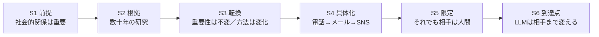

# D3秋学期ターゲット学会報告
- 2026/11/○○
- 30分

## 研究テーマ
- 長期的インタラクションにおける人間と対話ロボットの励まし発話が高齢者の主観的幸福感に与える影響

## 研究の最終目的
- 人間同士の対話と人間ーロボットの対話を比較し、長期間のインタラクションを通じて、人間と対話ロボットによる励まし発話が、悩みを持つ高齢者の主観的幸福感に与える影響を明らかにする

## ターゲット学会報告の目的
1. 2026年に *Nature Human Behaviour* に掲載された論文1本（AIコンパニオンとの対話と心理的ウェルビーイング）を詳しく紹介し、自分の研究の位置づけを明確にする
    - 心理学・行動科学系のトップジャーナルで、Human–AI interaction × well-being をどのような研究デザイン・分析・書き方で扱っているかを手本にする
2. この論文の**英語の書き方**（段落の設計、1文ごとの役割、結果の書き方）を分析し、自分の論文執筆に活かせることをまとめる
    - ターゲット学会：International Conference on Human-Robot Interaction (HRI)（学会）、IEEE International Conference on Robot & Human Interactive Communication (RO-MAN)（学会）、International Journal of Social Robotics（雑誌）など

#### *過去の内容
- [M1春学期のターゲット学会報告](https://github.com/kikuchiken-waseda/Xiang-Lingxuan/blob/master/M1/seminar/spring/20220711%E3%82%BF%E3%83%BC%E3%82%B2%E3%83%83%E3%83%88%E5%AD%A6%E4%BC%9A.md)：対話エージェントがある方法を使って人間の主観的幸福感を向上させる先行研究1件を共有した
- [M1秋学期のターゲット学会報告](https://github.com/kikuchiken-waseda/Xiang-Lingxuan/blob/master/M1/seminar/autumn/20221128%E3%82%BF%E3%83%BC%E3%82%B2%E3%83%83%E3%83%88%E5%AD%A6%E4%BC%9A.md)：2017年以降のAAAI Spring Symposium、HAI、IEEEなどの学会における「対話エージェントによりユーザのwell-beingを高める研究」を共有した
- [M2春学期のターゲット学会報告](https://github.com/kikuchiken-waseda/Xiang-Lingxuan/edit/master/M2/seminar/spring/20230703%E3%82%BF%E3%83%BC%E3%82%B2%E3%83%83%E3%83%88%E5%AD%A6%E4%BC%9A.md)：2023の3月のAAAI 2023 spring symposium＋他の学会の「対話エージェントによりユーザのwell-beingを高める研究」、関連研究、自分の研究に近い研究をまとめた
- [M2秋学期のターゲット学会報告](https://github.com/kikuchiken-waseda/Xiang-Lingxuan/edit/master/M2/seminar/autumn/20231120%E3%82%BF%E3%83%BC%E3%82%B2%E3%83%83%E3%83%88%E5%AD%A6%E4%BC%9A.md)：2018年以降に調べてきた「対話エージェントがある方法を用いて人間のwell-beingを高める研究」と、今後ターゲット学会となりそうな国際会議に関する情報をまとめた
- [D1春学期のターゲット学会報告](https://github.com/kikuchiken-waseda/Xiang-Lingxuan/blob/master/D1/spring/seminar/20240701%E3%82%BF%E3%83%BC%E3%82%B2%E3%83%83%E3%83%88%E5%AD%A6%E4%BC%9A.md)：前のまとめからまだ調べきれていない先行研究の追加:2023年および2024年のHRI国際会議から2件を紹介した
- [D1秋学期のターゲット学会報告](https://github.com/kikuchiken-waseda/Xiang-Lingxuan/edit/master/D1/autumn/seminar/20241125%E3%82%BF%E3%83%BC%E3%82%B2%E3%83%83%E3%83%88%E5%AD%A6%E4%BC%9A.md)：前のまとめからまだ調べきれていない先行研究の追加:2024年のInternational Journal of Social Roboticsの論文2件を追加で紹介し、自分の研究の位置づけを明確
- [D2春学期のターゲット学会報告](https://github.com/kikuchiken-waseda/Xiang-Lingxuan/blob/master/D2/spring/seminar/20250630%E3%82%BF%E3%83%BC%E3%82%B2%E3%83%83%E3%83%88%E5%AD%A6%E4%BC%9A.md)：前のまとめからまだ調べきれていない先行研究の追加:2025年のAAAI Spring Symposiumの学会1件とInternational Journal of Social Roboticsの論文1件を追加で紹介した
- [D2秋学期のターゲット学会報告](https://github.com/kikuchiken-waseda/Xiang-Lingxuan/blob/master/D2/autumn/seminar/20260126%E3%82%BF%E3%83%BC%E3%82%B2%E3%83%83%E3%83%88%E5%AD%A6%E4%BC%9A.md)：前のまとめからまだ調べきれていない先行研究の追加:2025年のACM Transactions on Human-Robot Interactionのレビュー論文1件を追加で紹介し、自分の研究の位置づけを明確
- [D3春学期のターゲット学会報告](https://github.com/kikuchiken-waseda/Xiang-Lingxuan/blob/master/D3/spring/seminar/20260601%E3%82%BF%E3%83%BC%E3%82%B2%E3%83%83%E3%83%88%E5%AD%A6%E4%BC%9A.md)：前のまとめからまだ調べきれていない先行研究の追加:2026年のAAAI Spring Symposiumの論文1件とJournal of Experimental Social Psychologyの論文1件を紹介した

|ポイント|自分の研究|先行研究|
|:---:|:---:|:---:|
|対話エージェント実体の有無|実体あり|実体あり？なし？|
|言語/非言語|言語|言語か？非言語か？|
|音声/テキスト|音声|音声？テキスト？|
|WoZ/自動生成|自動生成|WoZ？自動生成？|
|well-beingに関わる感情|Subjective Well-being, SWB（主観的幸福感/高齢者の場合、主観的健康感など）|どのような感情を研究するか？|
|well-beingを高める方法|効果的な励まし発話を提示|どのような方法を使ったか？|
|対象|高齢者|誰？|
|対照実験|対人間 vs. 対ロボット|？　vs. ？|
|インタラクションの期間と毎回インタラクションの長さ|長期（6週間）、週1回（毎回20分程度）|長期？短期？毎回インタラクションの長さは？|
|評価（主観評価/客観評価）|主観評価|主観評価?客観評価?|

## 調べた内容
- **対話エージェント**が**人間のwell-being**と**どのように関係するか**
  - [Nature Human Behaviour](https://www.nature.com/nathumbehav/) の論文1件（2026年8月オンライン公開、Vol.10, October 2026）
- キーワード：AI companion, chatbot, companionship, self-disclosure, social support, psychological well-being など

## 紹介する論文

|タイトル|年|著者|学会名/雑誌名|URL|
|:---|:---:|:---:|:---:|:---:|
|Interaction with AI companions and psychological well-being|2026|Yutong Zhang, Dora Zhao, Jeffrey T. Hancock, Robert Kraut, Diyi Yang|[Nature Human Behaviour](https://www.nature.com/nathumbehav/), 10, 1966–1980 (2026/08/04 online)|[URL](https://doi.org/10.1038/s41562-026-02516-2)|

- 所属：Stanford University（Computer Science / Communication）、Carnegie Mellon University
- 分析コード・匿名化した量的データ：[GitHub (SALT-NLP/AI-companionship-well-being)](https://github.com/SALT-NLP/AI-companionship-well-being)

---

## 発表の時間配分（30分）
- 前半（約18分）で論文を紹介し、後半（約12分）で自分の研究との関係と論文の書き方を話す

|時間|内容|使う図表|分|
|:---|:---|:---:|:---:|
|0:00–1:00|導入：今回の位置づけ（前回までの流れ、なぜこの論文か）|—|1|
|1:00–3:30|背景・2つの仮説・目的|—|2.5|
|3:30–7:00|対象・データ・測定方法・分析の考え方|Figure 1|3.5|
|7:00–9:00|結果①：利用目的と実際の会話内容|Figure 2|2|
|9:00–10:30|結果②：現実の人間関係とAIの使い方|Table 1|1.5|
|10:30–15:00|**結果③④：利用強度・companionship・自己開示とwell-being（中心）**|Table 2 / Figure 3|4.5|
|15:00–16:30|結果⑤：AIは人間関係の代わりになるか|Table 3|1.5|
|16:30–18:00|結果⑥・考察・限界|Figure 4|1.5|
|18:00–21:00|比較・自分の研究との関係|比較表|3|
|21:00–26:30|**論文の書き方の分析（精読）**|原文 p.1966–1971|5.5|
|26:30–28:30|学んだこと・自分の論文への応用|英文ドラフト|2|
|28:30–30:00|まとめ・予備時間|—|1.5|

- 時間が押した場合：Table 1 は Social network の行だけ、Figure 4 は(b)だけを説明し、残りは資料に残して質疑で使う
- Table 2 は全部の数字を読まず、「主効果は3モデルで一貫／交互作用は1モデルだけ」の2点に絞る

---

## 研究詳細

### Nature Human Behaviour：研究1
- [Interaction with AI companions and psychological well-being](https://doi.org/10.1038/s41562-026-02516-2)

---

### 背景（⏱ 1:00–3:30）
- 人間は社会的な存在であり、社会的関係は情緒的支援・companionship・所属感を与える、心理的健康とwell-beingの重要な要素である。数十年の研究が、強い社会的つながりが身体的・精神的健康を改善することを示してきた
- 電話・メール・SNSなどの技術は、人がつながる**「方法」**を変えてきたが、つながる相手は基本的に**人間**だった
- LLMの登場は、**「どうつながるか」だけでなく「誰とつながるか」**を変えた：LLMを用いたchatbotは言葉・口調・対話スタイルが人間に近くなり、**AIコンパニオン**という現象が生まれた
  - 従来のタスク支援型AIと異なり、AIコンパニオンは感情的に応答する会話を行い、友人・恋人などの親密な社会的役割を担うことがある（Character.AIのようなペルソナ型chatbot）
- **期待される理由**
  - いつでも利用できる、評価されない（non-judgemental）と感じられる、人に言いにくい個人的な内容も開示しやすい
  - 先行研究では、短期的な気分の改善や孤独感の低減、自殺予防への寄与も報告されている
- **懸念される理由**
  - chatbotには真の互恵性（reciprocity）がなく、追従的（sycophantic）・説得的な振る舞いをしやすい（エンゲージメント重視の設計）
  - 感情的な過依存、現実の人間関係の置き換え、非現実的な親密さへの期待
  - Replikaの利用者がchatbotを「感情的な欲求を持つ存在」と感じ、相互義務の錯覚を持った例
  - キャラクター型プラットフォームのモデレーション不足（未成年への不適切な対応、自傷・摂食障害の助長などの報道）
- **先行研究の知見は混在している**：苦痛や孤独感の低減を示す研究もあれば、感情的依存や有害な関係パターンを示す研究もある。治療目的に設計されたchatbotでは良い結果が多いが、**治療目的ではない日常的な利用**については十分に分かっていない
- → 本研究は、chatbot利用を「一様な行動」として扱わず、**関係的な視点（relational lens）**から、**利用強度・自己開示・現実の社会的支援**がどのように組み合わさってwell-beingと関連するかを調べた

#### 論文で使われる2つの仮説

|仮説|内容|この論文で確かめたこと|
|:---|:---|:---|
|社会的補償仮説（Social compensation）|現実の人間関係が少ない人は、オンラインやAIなど別のつながりで不足を補おうとする|現実の親しい人が少ない人ほど、AIをcompanionship目的で使うのか／それでwell-beingが補われるのか|
|社会的代替仮説（Social substitution）|AIとの強い関わりが、現実の人間関係から得られる心理的利益を弱める|利用強度が高い人では、現実の人間関係とwell-beingの関連が弱いのか|

- 🤔注意：この論文は2つの仮説を解釈の枠組みとして使っているが、「AIが人間関係を減らした」こと自体は検証していない（横断データのため）

---

### 目的
- Character.AIの利用者を対象に、**AIを話し相手として使うこと（companionship）**と**心理的ウェルビーイング**の関連を、利用の仕方と現実の人間関係の両面から明らかにする
- 発表用に問いを整理すると以下の5つ（※著者が番号を付けたRQではない）
  1. ユーザはどのような目的でchatbotを使っているか。本人の申告と実際の会話は一致するか
  2. 現実に親しい人が少ない人ほど、AIをcompanionship目的で使うか
  3. 利用強度とcompanionship利用は、それぞれwell-beingとどう関連するか
  4. その関連は、利用強度や自己開示の程度によって変わるか
  5. 現実の社会的つながりが少ない人にとって、AI companionshipはwell-beingの面で「補い」になっているか

#### 研究の種類（ここが自分の研究と大きく違う）
- **混合研究法（mixed-methods）による横断的な観察研究**
  - 質問紙（1,131人）＋ 参加者が提供した過去のチャット履歴（237人）を組み合わせた
- 参加者を条件にランダムに割り当てる**介入実験ではない**、well-beingを繰り返し測る**縦断研究でもない**
- → 「関連（association）」は言えるが「因果」は言えない

---

### 対象（⏱ 3:30–7:00）
- 米国在住・英語母語話者のCharacter.AI利用者（オンライン募集サービス **Prolific** で募集）
- 参加条件：Character.AIの利用歴が**1か月以上**、かつ**3種類以上のchatbot**と対話した経験がある
- 2,836人が登録 → 1,417人が条件を満たす → **1,131人**が質問紙を完了（最終分析対象）
  - 質問紙：Qualtrics、所要約10分、謝礼4米ドル
  - うち**237人**がチャット履歴も提供（**4,664セッション、464,687メッセージ**）、追加謝礼20米ドル
  - 履歴の提供には独自のChrome拡張機能を使用。参加者は提出前に個人情報を伏せたり、提出する会話を選んだりできた
- 属性
  - 性別：男性48.5%、女性46.2%、ノンバイナリー5.1%
  - 年齢：18–25歳41.8%、26–35歳32.7%、36–50歳18.7%、50歳以上6.8% → **若い成人が中心**
  - 交際状況：シングル40.3%、交際中59.5%
  - 利用歴：1–3か月15.8%、3か月–1年34.3%、**1年以上49.9%**
- データ収集期間：2024年10月〜2025年1月（提供された履歴は2022年11月〜2025年1月の範囲）
- サンプルサイズ：事前の検定力分析ではなく、最小の関心効果量を |β| = 0.10 と設定。感度分析では、α = .05で β ≈ 0.08 を80%の検定力で検出できる
- 倫理審査：Stanford University IRB承認

#### なぜCharacter.AIか
- 性格・役割を設定したキャラクター型chatbotと対話できるサービス。利用は質問応答に限らず、雑談・相談・ロールプレイ・恋愛的な会話などに広がり、個人化され、感情を伴いやすい
- → AIを「社会的な相手」として使う現象を観察するのに適している

---

### データと測定

#### 研究全体の見取り図（Figure 1, p.1968）

- 上段：AI companionshipを**3つの方法**で測る（①主な利用目的、②関係の自由記述、③実際のチャット履歴）
- 中段：**利用強度（interaction intensity）**と**自己開示（self-disclosure）**
- 下段：**現実の社会的支援（親しい親族・友人の数）**と**well-being（6つの側面）**
- →🤔この図は「操作→効果」の実験手順ではなく、質問紙と履歴をどう組み合わせて「関連」を見るかを示す図

#### Companionshipの3つの測り方（triangulation：三角測量）

|指標名|何をしたか|値の意味|妥当性の確認|
|:---|:---|:---|:---|
|CompanionshipPrim.|主な利用目的を4つ（relational / entertainment / productivity / curiosity）から1つ選ぶ|relationalを選んだら1、それ以外0|—（強制選択のため複合的な利用を捉えにくい）|
|CompanionshipDesc.|よく使うbotとの関係を自由記述 → GPT-4oで4つの目的ごとに分類（複数可）|例：「友人でありツール」→companionship=1、productivity=1|50件を3名の評価者が確認、平均一致率92%（Fleiss's κ = 0.87）|
|CompanionshipChat|237人の履歴：Llama 3-70Bでセッションを要約 → GPT-4oで目的を分類|セッションのうちcompanionship型の割合（連続値）|評価者間一致 κ = 0.95（要約）/ 0.84（分類）、モデルとの一致97% / 93%|

- 🤔3つは「同じもの」を測っているわけではない：ロールプレイが主目的の人も会話では悩み相談をするかもしれないし、恋愛的な会話もフィクションとして演じているだけかもしれない

#### その他の指標

|指標|尺度|内容|信頼性|
|:---|:---|:---|:---:|
|主観的well-being|Comprehensive Inventory of Thriving（CIT）から6項目|生活満足度、ポジティブ感情、ネガティブ感情（逆転）、孤独感（逆転）、社会的支援、所属感。各構成概念で最も負荷の高い1項目を選び平均|α = 0.88|
|利用強度|Facebook Intensity Scale を改変（7項目）|利用するbotの数、1日の利用時間（行動面）＋感情的なつながり・日常への組み込み（態度面）|α = 0.86|
|自己開示（質問紙）|Message Orientation in Computer-Mediated Communication の自己開示下位尺度を改変（7項目・7件法）|chatbotに個人的な考え・気持ち・経験を話しやすいか|α = 0.89|
|自己開示（会話）|Balani & De Choudhury の基準でLlama 3-70Bが分類|各メッセージを high / low / none に分類|評価者との一致92%（κ = 0.89）|
|現実の社会的支援|Lubben Social Network Scale を改変（2項目）|「個人的なことを安心して話せる親族／友人は何人か」（0人〜9人以上の6段階）、合計2〜12点（M = 5.73, SD = 1.98）|—|

- 注意1：利用強度は「使用時間」だけでなく、AIとの感情的な結びつきに近い項目も含む
- 注意2：利用強度は2因子モデルの方が適合はやや良かったが、2因子の相関が r = 0.88 と高く結果も変わらないため、1因子にまとめている
- 注意3：Table 2の交互作用に使う自己開示は**質問紙**、Figure 4の話題分類は**会話履歴**であり、別の指標

#### 分析方法
- **重回帰分析**：年齢・性別・交際状況・利用歴を統制して関連を推定（係数はすべて標準化係数β、95% CI、両側検定）
- **交互作用**：例「companionshipが主目的の人では、利用強度とwell-beingの関係が違うか」
- **Heckman selection model**：履歴を提供した237人に偏りがある可能性を補正
- **TopicGPT**：大量の会話からテーマを抽出（intrusion testで一貫性を確認）
- **帰無仮説の検討**：Bayes factor と等価性検定（equivalence test）で「効果がない」ことを積極的に検討

---

### 結果

#### 結果① 実際の会話には、どんな利用目的が含まれるか（Figure 2, p.1969）（⏱ 7:00–9:00）

- ⚠️発表時の注意：Figure 2(b)には自殺・自傷に関わる会話例（言い換え済み）が含まれる。スライドでは会話例部分を隠すか、事前に一言断る

- **(a) 4つの利用目的の定義**：Companionship（友人・恋人・セラピスト・聞き手など）、Entertainment（娯楽・時間つぶし）、Productivity（道具・情報取得）、Curiosity（好奇心・能力の探索）
- **(b) 会話履歴のテーマ（セッション単位の出現率）**

|テーマ|出現率|
|:---|:---:|
|感情的・社会的サポート（悩みや健康の相談）|80.33%|
|共同での物語づくり・キャラクターのロールプレイ|77.87%|
|恋愛・親密なロールプレイ|68.03%|
|危険・暗いロールプレイ（タブーな設定など）|30.74%|
|批判的な議論・戦略的分析|24.59%|
|哲学的・道徳的な探究|22.95%|

- 1つのセッションに複数テーマが含まれるため、合計は100%にならない

- **3つのデータで見えるcompanionshipの割合が大きく違う**

|データ|companionshipの割合|
|:---|:---:|
|主な利用目的として選んだ人（質問紙）|**11.8%**|
|自由記述で「友人」「恋人」などの関係語を使った人|**51.0%**|
|履歴を提供した人のうち、companionship型の会話が1回以上あった人|**92.9%**|

- 主目的にcompanionshipを選ばなかった人でも、46.8%が自由記述で関係語を使い、47.8%は履歴にcompanionship型の会話があった
- 自由記述では45.8%が友人・家族のような関係、11.8%が恋愛的な関係として表現。41.4%は複数の目的にまたがっていた
- →🤔「一番の目的」「関係をどう言葉にするか」「1回でも出てきたか」はそもそも違う問い。92.9%は「92.9%がAIを本当の友人と思っている」という意味ではない（会話が多い人ほど「1回以上」に該当しやすい）
- →🤔フィクションとしての親密さ（ロールプレイ）と、現実の孤独を補う親密さが同じカテゴリーに入っている可能性がある

#### 結果② 現実の人間関係とAIの使い方（Table 1, p.1970）（⏱ 9:00–10:30）

- 特に見る行：**Social network（親しい人の数）**

|従属変数|Social network の係数 β|p|解釈|
|:---|:---:|:---:|:---|
|(1) 利用強度|0.01|.672|関連なし|
|(2) CompanionshipPrim.|**−0.03**|**< .001**|親しい人が少ないほど、companionshipを主目的に選びやすい|
|(3) CompanionshipDesc.|−0.03|.056|境界的|
|(4) CompanionshipChat|−0.00|.970|関連なし|
|(5) 自己開示|**−0.10**|**< .001**|親しい人が少ないほど、chatbotに個人的なことを話しやすい|

- その他：利用歴が長いほど利用強度が高い（β = 0.25）→ 使うほど関わりが深まる強化サイクルの可能性。ノンバイナリーの人は利用強度は低いがcompanionship利用は多い（社会的補償仮説と整合）。シングルの人は利用強度もcompanionship利用も低い（補償仮説とは逆）
- →🤔「親しい人が少ない人はAIを**たくさん**使う」ではなく、「**何のために**使うか」が違う、という結果。しかも3つのcompanionship指標すべてで有意だったわけではない

#### 結果③ 利用強度とcompanionshipは、well-beingとの関係が逆向き（Table 2, p.1971）（⏱ 10:30–15:00）

- **主効果（従属変数：well-being）**

|予測変数|(1) Prim.モデル|(2) Desc.モデル|(3) Chatモデル|
|:---|:---:|:---:|:---:|
|利用強度|**+0.27**（p < .001）|**+0.29**（p < .001）|−0.08（p = .431, n.s.）|
|Companionship|**−0.48**（p < .001）|**−0.32**（p < .001）|**−0.27**（p = .004）|

- 全体として利用強度が高い人はwell-beingが高い（ただし履歴モデルでは有意でない）
- しかし利用強度を統制すると、**companionship利用は3つの測り方すべてで低いwell-beingと関連**した

- **交互作用**

|交互作用|(1) Prim.モデル|(2) Desc.モデル|(3) Chatモデル|
|:---|:---:|:---:|:---:|
|利用強度 × companionship|**−0.31**（p = .014）|0.01（p = .934）|−0.13（p = .144）|
|自己開示 × companionship|**−0.38**（p = .002）|−0.11（p = .185）|モデルが収束せず推定なし|

- → 交互作用は**主目的（Prim.）モデルでのみ有意**
- 注意：Chatモデルの n = 1,131 は Heckman selection model の結果であり、1,131人全員の会話履歴があるという意味ではない（実際の履歴は237人分）

#### 結果④ 2つの交互作用をグラフで見る（Figure 3, p.1972）

- 青：non-companionship、ピンク：companionship（主目的で分類）
- **(a) 利用強度**：青は利用強度が高いほどwell-beingが高い。ピンクはほとんど上がらない（β = −0.31, 95% CI [−0.56, −0.06]）
- **(b) 自己開示**：ピンクは自己開示が高いほどwell-beingが低い（β = −0.38, 95% CI [−0.63, −0.14]）
- 著者の解釈（2つの可能性を併記）
  1. companionship目的で強く頼ると、人の代わりにchatbotに向かう習慣ができ、well-beingが低くなる
  2. もともとwell-beingが低い人ほど、chatbotに話し相手を求め、多く使い、多く話す
  - どちらにしても、chatbotへの依存が関係的な欲求への対処になっている**脆弱なサブグループ**がいることを示す
- →🤔ピンクの線が下がっていても「AIに悩みを話したせいで悪くなった」とは言えない。逆の因果も残る

#### 結果⑤ AIは「人間関係の代わり」になっているか（Table 3, p.1974）（⏱ 15:00–16:30）

|予測変数|β|p|解釈|
|:---|:---:|:---:|:---|
|現実の社会的ネットワーク|+0.49〜+0.76|< .001|親しい人が多いほどwell-beingが高い（既存研究と一致）|
|companionship × 社会的ネットワーク|+0.07 / +0.01 / −0.02|.514 / .838 / .836|3モデルとも有意でない|
|利用強度 × 社会的ネットワーク|**−0.11**|**< .001**|利用強度が高い人では、現実の人間関係とwell-beingの正の関連が弱い|

- 「効果がない」ことを積極的に検討：Bayes factor BF01 = 6.55（交互作用なしモデルの方がデータに合う）、等価性検定でも交互作用は ±0.10 の範囲内（t = −3.15, p < .001）
- → 親しい人が少ない人はAIをcompanionshipとして求めやすいが、**それで低いwell-beingが補われている証拠はない**（社会的補償仮説は支持されない）
- → 利用強度が高いと現実の人間関係の利益が弱まる（社会的代替仮説と整合）
- →🤔「補う証拠がない」と「AIが人間関係を奪ったことを証明した」は全く違う

#### 結果⑥ 自己開示の話題と、ユーザが感じた長所・短所（Figure 4, p.1973）（⏱ 16:30–18:00）

- **(a) 会話履歴の自己開示の話題**
  - High self-disclosure：感情的な苦痛 60.85%、恋愛的なつながりへの欲求 41.42%、現在の生活上の困難 31.54%、**自殺念慮 18.03%**、友情への欲求 18.01%、物質使用 17.46%、仕事のストレス 15.15%
  - Low self-disclosure：現在の生活上の困難 26.59%、哲学的な視点 26.15%、感情的な反応 19.88%、友情への欲求 15.71%、学習上の限界 12.87% など、比較的抽象的
- **(b) 本人が自由記述で答えた影響（TopicGPTで分類）**

|良い影響（上位）|割合|悪い影響（上位）|割合|
|:---|:---:|:---|:---:|
|感情的サポート|33.33%|悪影響なし|25.11%|
|娯楽・余暇|31.74%|時間の消費|21.84%|
|知的探究|26.44%|社会的な断絶|18.83%|
|創作支援|22.72%|感情的依存|12.82%|
|アイデンティティ・社会的スキルの探索|18.48%|社会的な期待の歪み|8.66%|
|companionship・孤独感の低減|17.51%|chatbotへの過度な依存|7.87%|

- →🤔良い経験も悪い経験も挙がっている。Table 2の負の関連だけで、すべてのユーザの経験を説明することはできない

#### 主要な知見のまとめ
1. **companionship利用は、本人の申告よりも実際の会話にずっと多く現れる**（11.8% vs. 92.9%）
2. **現実に親しい人が少ない人ほど、AIをcompanionship目的で使い、より多く自己開示する**
3. **全体的な利用強度は高いwell-beingと関連するが、companionship利用は低いwell-beingと関連する**（3つの測り方で一貫）
4. **その負の関連は、利用強度・自己開示が高いほど強い**（主目的モデルのみ）
5. **AI companionshipが現実の人間関係の不足を補っている証拠はない**

---

### 考察の要点
- **「量」と「役割」を分けたこと**が最大の貢献：同じ「よく使う」でも、AIに何を求めているかでwell-beingとの関連が逆になる
  - SNS・テレビ・ゲームの研究でも、well-beingを左右するのは総利用量より使い方のパターンであるという知見と並行している
- **自己開示は人間関係では親密さ・well-beingにつながるが、AIでは同じとは限らない**：高い自己開示の会話には苦痛や危機に関する内容が多く、人間関係にある互恵的なやりとりがないまま、より脆弱な状態を開示している可能性がある
- **AIは現実の人間関係を「補強」はしても「代替」はできない**：AIの影響は使い方だけでなく、その人の社会的環境にも依存する
- ユーザの声から見える**負の強化ループ**：孤独を和らげるためにAIに向かう → 強い依存が現実の交流をさらに置き換える → 解消したかった断絶が強まる
- **設計への提言**（研究で検証した介入ではなく、結果から考えられる提案）
  - chatbotが人間ではなく、感情や経験を持たず、人間のケアの代わりにはならないことを明示する
  - 苦痛の兆候を検出する仕組みと、専門家・人間による支援への誘導
  - AIへの依存を強めるのではなく、社会的スキルや関係への意識を促す
- **今後の研究**：ユーザの期待が時間とともにどう変わるか、頻繁な利用が現実の支援ネットワークや援助要請を置き換えるか、短期利用者と長期利用者の比較、**縦断研究・ランダム割付の実験**

### 限界（著者が挙げたもの）
- **因果関係が分からない**：横断データのため、AIがwell-beingを下げたのか、well-beingが低い人がAIを求めたのか区別できない（逆因果・残余交絡）
- **自己報告への依存**、CompanionshipPrim.は強制選択で複合的な利用を捉えにくい
- **履歴データの限界**：237人のみで、参加者が提出する会話を選べた（選択的報告）。TopicGPTはセッション単位の分析で、会話をまたいだ関係の変化は捉えられない
- **プラットフォームの変化**：期間中のCharacter.AIのモデレーションや設計の変更を外部から把握できない
- **一般化の限界**：Character.AIのみ、米国・英語話者・Prolific利用者、Chrome拡張が必要だったためデジタルリテラシーの高い人に偏る

### データ・コードの公開
- 分析コードと匿名化した量的データをGitHubで公開。LLM分類のプロンプトや評価手順もSupplementary Informationに掲載
- 元のチャット履歴は、匿名化しても再特定のリスクがあり、同意の範囲外のため非公開
- →🤔他の研究者が分析手順を確認・再分析しやすい（透明性）。ただし「生データすべてが公開されている」「誰でも完全に再現できる」という意味ではない

---

### 比較（⏱ 18:00–21:00）

| ポイント | 先行研究（Zhang et al., 2026） | 自分の研究 |
| :--- | :--- | :--- |
| 目的 | AIをcompanionshipとして使うこととwell-beingの関連を、利用の仕方と現実の人間関係から明らかにする | 励まし発話を提供する対話ロボットによって高齢者の主観的幸福感を向上させる |
| 研究の種類 | 横断的な観察研究（質問紙＋チャット履歴）、介入なし | 縦断的な対照実験（6週間） |
| 対話エージェント実体の有無 | 実体なし（Character.AIのキャラクター型chatbot） | 実体あり |
| 言語／非言語 | 言語 | 言語 |
| 音声／テキスト | テキスト | 音声 |
| WoZ／自動生成 | 自動生成（Character.AIのペルソナ型LLM） | 自動生成（ChatGPT-4o） |
| 対照実験 | なし（利用目的・利用強度・自己開示の個人差を回帰分析で比較） | 対人間 vs. 対ロボット、高効果励まし vs. 低効果励まし |
| 対象 | 米国のCharacter.AI利用者1,131人（若い成人が中心）、うち237人が履歴提供 | 悩みを持つ高齢者18名 |
| well-beingとは | CITの6項目（生活満足度、ポジティブ／ネガティブ感情、孤独感、社会的支援、所属感） | 主観的幸福感（WHO-5・SWLS） |
| well-beingとの関係を見る要因 | companionship利用、利用強度、自己開示、現実の社会的ネットワーク | 対話相手（人間／ロボット）、励まし発話のタイプ |
| インタラクションの期間と毎回の長さ | 利用歴1か月以上（約半数は1年以上）の自由利用、1回の長さは統制なし | 6週間、週1回、毎回の対話5〜10分程度（アンケート含め20分程度） |
| 評価（主観評価／客観評価） | 主観評価（質問紙）＋会話履歴のLLM分類 | 主観評価（WHO-5・SWLS） |
| 着目点 | AIを「どれだけ」使うかではなく、「何のために」「どのように」使うか | 同じ励まし発話でも、人間とロボットで主観的幸福感への影響が異なるか |
| 主な結果 | companionship利用は低いwell-beingと関連し、利用強度・自己開示が高いほどその関連が強い。現実の人間関係の不足を補う証拠はない | 人間条件とロボット条件、励ましタイプ間の効果を比較する |
| 限界 | 因果が分からない、若い米国のオンライン利用者のみ、テキストのみ | 高齢者を対象に、縦断・実験デザインで因果的な比較を行う（ただし小標本） |

---

### 自分の研究との関係

#### 共通する問題意識
- この研究は、AIを「道具」ではなく**関係の相手**として捉え、その関わりがwell-beingとどう関係するかを問うている点で、自分の研究と共通の問題意識を持っている
- D3春学期に紹介した Li et al.（2026）は「高度に支持的なchatbotでも、ランダムな人間のpeerほど孤独感を下げなかった」という**実験**の結果だった。今回のZhang et al.（2026）は**大規模な実利用データ**から、「AI companionshipは現実の人間関係の不足を補っていない」ことを示している
  - →🤔異なる方法で同じ方向の知見が出ている：**AIによる支援は人間関係の代替にはなりにくい**。だからこそ、自分の研究で「人間とロボットの励ましを同じ枠組みで比較する」ことに意味がある

#### 自分の研究への示唆
1. **自己開示 × companionship の負の交互作用**
   - 自分の実験では、参加者が毎回ロボットに**悩みを開示**する。自己開示そのものが研究の中心にある
   - →🤔ロボット条件で深い開示を続ける参加者のwell-beingの変化を個別に見る価値がある。参加者の発話を、この論文と同じ基準（high / low / none）でLLM分類し、開示の深さを探索的な指標として加えられる
2. **社会的補償：親しい人が少ない人ほどAIに頼る**
   - 悩みを持つ高齢者には、周りに相談できる人が少ない人もいる。そうした人ほどロボットに頼りやすい可能性がある
   - →🤔この論文が使った**Lubben Social Network Scale**は、もともと高齢者向けに開発された尺度（引用文献84も高齢者向け短縮版LSNS-6の論文）。ベースラインで測定し、**調整変数・共変量**として分析に入れることを検討したい
3. **「量」と「役割」を分ける**
   - 6週間の実験では、ロボットとの対話量はほぼ統制されているが、参加者がロボットを**どのような存在と捉えているか**（話し相手／道具／好奇心の対象）は人によって違うはず
   - →🤔ロボットに対する態度（NARS・RAS）に加えて、ロボットとの関係を自由記述で聞き、関係の捉え方の変化を追うことができる

#### この論文から取り入れたい方法
- **複数の操作化による頑健性の確認**：主効果は3つの測り方で一貫していたが、交互作用は1つの測り方だけだった。自分の分析でも、WHO-5とSWLSで結果が一致するかを分けて報告したい
- **帰無結果の扱い方（Bayes factor・等価性検定）**：人間条件とロボット条件で有意差がなかった場合、「差がない＝同等」とは言えない。小標本（18名）だからこそ、等価性検定やBayes factorで「どの程度同等と言えるか」を示す方法は参考になる
- **LLM分類の妥当性確認**：LLMで分類した結果を3名の評価者が確認し、一致率とFleiss's κを報告している。自分が励まし発話のタイプや参加者の発話をLLMで分類する場合も、同じ手順で妥当性を示したい

#### 位置づけ
- 著者らは今後の課題として**縦断研究**と**ランダム割付の実験**を挙げている
- 自分の研究は、**6週間の縦断デザイン**で、**人間 vs. ロボット**を実験的に比較する。この論文が横断データでは答えられなかった「AIとの関わりがwell-beingを変えるのか」という問いに、**高齢者・音声対話・身体を持つロボット・励まし発話**という文脈で答えようとする研究として位置づけられる
- 一方で相違点も大きい
  - 若い米国のオンライン利用者 vs. 日本の高齢者
  - テキスト vs. 音声＋身体性
  - 自由な日常利用 vs. 週1回の構造化された対話
  - 目的の広いcompanionship vs. 悩みに対する特定の励まし

#### 感想
- 「AIをよく使う人はwell-beingが高い」「companionship目的の人は低い」という一見矛盾する結果を、**利用量と役割を分ける**ことで整理しているのが分かりやすかった
- 自分の研究でも、ロボットの励ましが「効くかどうか」だけでなく、**誰にとって・どのような関わり方のときに**効くのかを考える必要がある
- 著者の設計提言（AIが人間でないことを明示する、深刻な苦痛を検出して人間の支援につなぐ）は、悩みを扱う自分の実験の**倫理面**でもそのまま当てはまる。深刻な悩みが語られた場合の対応手順をあらかじめ決めておきたい

---

## 論文の書き方から学ぶ（⏱ 21:00–28:30）

### なぜ書き方を取り上げるか
- この論文は、研究内容だけでなく英語そのものがとても読みやすい。英文ライティングの授業のように、段落を取り出して**1文ずつ「役割」「表現」「前後のつながり」**を見ていく
- 結論を先に言うと、読みやすさの理由は難しい表現ではなく、**1文に1つの役割があり、どの文を削っても論理のどこかが抜ける**構成にあると思う
- ※各文の「📌 原文」の欄に、PDFから該当する英文を貼って使う（場所はページ・段・段落・文番号で指定）。スライドでも原文を表示し、分析する部分をハイライトする。下の分析は自分の読み方であり、著者による解説ではない

### 1. 全体の構造

#### Introductionの段落設計図（p.1966–1967）

|段落|役割|内容の要約|
|:---:|:---|:---|
|1|前提と変化|社会的関係はwell-beingに重要 → 技術はつながり方を変えてきた → LLMは「相手」まで変える|
|2|現象の提示|AIコンパニオンとは何か、なぜ人間とAIの境界が曖昧になるのか|
|3|期待（賛成側）|AIが人間関係の利益を再現・超えうる理由と、その証拠|
|4|懸念（反対側）→ 問い|互恵性の欠如、依存、モデレーション失敗 → 「AIは人の欲求を満たすのか、新たな脆弱性を生むのか」|
|5|ギャップ → 本研究の視点|知見の混在、治療目的のchatbotとの違い → 関係的な視点で3つの要因を見る|
|6–7|方法と主な結果の予告|Character.AI、三角測量、測定 → 結果の要約|

- 段落3と4が**賛成側と反対側を同じ重みで並べ**、段落4の最後を**問い**で終える。読者は「答えは分からない、だから調べる必要がある」という状態で段落5に入る
- 段落5で「何が分かっていないか」を示し、段落6で「どう調べるか」に進む。**問い → ギャップ → 方法**が一直線

#### Resultsの見出しがそのまま結論文になっている
- Resultsの小見出しはすべて**主語と動詞を持つ完全な文**で、その節の結論を述べている（例：「現実の社会的支援が少ない人ほどchatbot companionshipを求めやすい」「全体的な利用はwell-being高、companionship利用はwell-being低と関連する」）
- →🤔見出しを順に読むだけで、論文の主張がほぼ分かる。自分の論文でも「実験1の結果」のような見出しではなく、結論を書いた見出しを使いたい

#### Abstractの7文の役割
> 📌 **原文 Abstract**（p.1966 タイトル下の要旨、全7文）
> （ここにAbstractを貼る）

|文|役割|書き方の特徴|
|:---:|:---|:---|
|1|背景|LLM chatbotの表現力が高まり、ユーザが絆を形成し始めている現象を1文で提示|
|2|目的|This study investigates ... で研究の問いを1文で|
|3|データ|1,131人、4,664セッション、464,687メッセージと**規模を数字で**示す|
|4|方法の工夫|3つのデータを三角測量するという独自性を述べる|
|5|主な結果|社会的ネットワーク → companionship → well-being を**βとCI付き**で示す|
|6|調整効果|利用が強い・開示が多いときに関連が強まることを示す|
|7|含意|関連は**一様ではなく**、オフラインの環境と使い方に依存すると慎重にまとめる|

- 🤔ただし注意点もある：文5の関係代名詞を使った連鎖的な書き方（社会的ネットワークが小さい → companionship → well-being低）は**媒介関係**を想起させるが、本文では媒介分析は行っておらず、別々の回帰モデルの結果を並べている。読み手としては表現が分析より強く見える部分に注意し、自分が書くときは**分析した内容と表現を一致させる**ことを意識したい

---

### 2. 精読①：Introduction 第1段落（p.1966 本文冒頭、6文）

**S1｜前提を置く**
> 📌 **原文 S1**（p.1966 本文左段・第1段落・第1文）
> （ここに原文を貼る）

- 骨格：`[人間の性質], and [X] are a critical component of [Y], providing [A], [B] and [C].`
- 役割：分野を問わず誰もが受け入れられる前提を置き、「社会的関係」を段落のテーマにする
- 表現：分詞構文 providing ... で「なぜ重要か」を同じ文の中で説明し、文を増やさない

**S2｜根拠を示す**
> 📌 **原文 S2**（p.1966 本文左段・第1段落・第2文）
> （ここに原文を貼る）

- 骨格：`Decades of research confirm that [X] improve [Y].`
- 役割：S1を感覚的な主張で終わらせず、長年の研究に基づく事実にする
- 表現：「数十年の研究」を主語にし、動詞 confirm で証拠の厚みを短く伝える。「多くの研究がある」とぼんやり書くより強い

**S3｜転換点：変わらないものと変わるもの**
> 📌 **原文 S3**（p.1966 本文左段・第1段落・第3文）
> （ここに原文を貼る）

- 骨格：`As [X] has remained consistent, [Y] have continuously evolved.`
- 役割：段落の転換点。「関係の重要性は不変／つながる方法は変化」という**安定と変化の対比**を1文で作る
- つながり：As節がS1・S2の内容（旧情報）、主節が新情報。次のS4で具体例を出す準備になっている

**S4｜抽象を具体化する**
> 📌 **原文 S4**（p.1966 本文左段・第1段落・第4文）
> （ここに原文を貼る）

- 骨格：`From A to B to C, each wave of [X] reshapes how [Y] are formed and sustained.`
- 役割：S3の「方法の変化」を、電話→メール→SNSの3例で具体化する
- 表現：From A to B to C で時間の流れを短く表し、each wave（波）という比喩で技術が次々に来るイメージを出す

**S5｜限定する（ここが一番うまい）**
> 📌 **原文 S5**（p.1966 本文左段・第1段落・第5文）
> （ここに原文を貼る）

- 骨格：`While [these tools] have transformed [X], they have largely remained grounded in [Y].`
- 役割：S4の変化を認めつつ、「それでも相手は人間だった」という**まだ変わっていなかったもの**を示す
- つながり：these tools でS4を受ける。While は単なる逆接ではなく、変化の範囲を限定している

**S6｜到達点**
> 📌 **原文 S6**（p.1966 本文左段・第1段落・第6文＝段落の最後の文）
> （ここに原文を貼る）

- 骨格：`The recent advent of [LLMs] introduces a more profound shift: it redefines not only how ..., but also whom ....`
- 役割：段落全体の到達点。ここで初めてLLMが主役になる
- 表現：コロンの後で more profound shift の中身を説明する。not only how ... but also whom ... は形をそろえた並列で、「手段」から「相手」への転換を印象的に示す

#### 1文削除テスト：どの文を削ると何が壊れるか

|削る文|壊れること|
|:---:|:---|
|S2|S1が根拠のない主張になる|
|S3|「重要性は変わらない」という軸がなくなり、S4の技術の話が唐突になる|
|S4|「方法の変化」が抽象的なままで、読者がイメージできない|
|**S5**|**S6の more profound（より根本的な）が何と比べて根本的なのか分からなくなる**|
|S6|段落の目的地がなくなり、AIの話につながらない|

- →🤔6文あるが、同じことを6回言っていない。特にS3とS5があるからこそS6に意味が生まれる。「精練」とは短い文を並べることではなく、**1文を削ると議論のどこかが抜ける**状態のことだと思った
- →🤔また、最初から「AIは新しい」「AIは重要」と言わない。**旧情報を受けて新情報を1つ足す**動きを繰り返し、最後の1文で初めて主題（LLM）を出している

---

### 3. 精読②：先行研究から本研究への橋渡し段落（p.1967 左段）

**S1｜ギャップを1文で**
> 📌 **原文 S1**（p.1967 左段・2つ目の段落〔ページ冒頭の続きの次〕・第1文）
> （ここに原文を貼る）

- 骨格：`Despite [A] and [B], empirical research on [X] remains nascent.`
- 役割：「社会では広く使われているのに、実証的な知識はまだ乏しい」という問題を提示する
- 表現：Despite A, B で「普及」と「研究不足」を対比。単に More research is needed. と書くより、**なぜ研究不足が問題なのか**が伝わる

**S2｜「不足」の中身を示す**
> 📌 **原文 S2**（p.1967 左段・同じ段落・第2文）
> （ここに原文を貼る）

- 骨格：`Prior studies report mixed findings: some highlight [利益], while others emphasize [リスク].`
- 役割：「研究が少ない」だけでなく、**知見が一致していない**ことを示す
- 表現：コロン＋ some ... while others ... の対称構文。mixed findings の意味をすぐ具体例で説明している

**S3｜良い結果が出た条件を限定する**
> 📌 **原文 S3**（p.1967 左段・同じ段落・第3文）
> （ここに原文を貼る）

- 骨格：`Research on [X] has shown that outcomes can be positive when [条件].`
- 役割：先行研究の良い結果を否定せず、それが「心理的支援のために設計されたシステム」の場合だと**条件を限定**する
- つながり：この限定によって、次の文で「では日常利用は？」という問いが自然に生まれる

**S4｜本研究を初めて登場させる**
> 📌 **原文 S4**（p.1967 左段・同じ段落・第4文）
> （ここに原文を貼る）

- 骨格：`Building on this literature, our study examines [X], where [条件A] but still [条件B].`
- 役割：ここで初めて our study が出る。治療目的ではないが、親密さ・開示・支援希求は含む「日常利用」を対象にすると明示
- 表現：Building on ... で先行研究から地続きであることを示す。not ... but still ... で対象の特徴を短く定義

**S5｜研究の視点と変数を宣言する**
> 📌 **原文 S5**（p.1967 左段・同じ段落・第5文＝段落の最後の文）
> （ここに原文を貼る）

- 骨格：`Rather than treating [X] as [Y], our study adopts [視点] to investigate [A], [B] and [C], and how these factors interact ...`
- 役割：従来の見方を避けるという**研究上の選択**と、測定する3つの要因（利用強度・自己開示・現実の社会的支援）を示す
- 🤔この文はかなり長い。しかし修飾を足しているだけではなく、「研究方針」と「変数」をまとめる役割がある。**良い英語＝必ず短い文、ではない**

#### この段落の一番うまいところ
- Despite（ギャップ） → mixed findings（知見の対立） → 治療目的という条件 → 日常利用（本研究の対象） → relational lens（本研究の視点）と、**1文ごとに論点が1段ずつ進む**
- 「研究が少ないから研究する」ではなく、**なぜ既存研究では答えきれないのか → だから何を変えて調べるのか**まで書いている

---

### 4. 精読③：Resultsの段落（p.1970 右段）

**Table 2を説明する段落の構造**
> 📌 **原文 段落全体（5文）**（p.1970 右段・3つ目の段落〔ページ冒頭の続き、"More intense..."の段落の次〕）
> （ここに原文を貼る）

|文|役割|書き方|
|:---:|:---|:---|
|1|結論を先に|However で前の結果（利用強度は正）と対比し、「利用強度を統制すると、companionshipは3モデルすべてで低いwell-beingと関連」と言い切る。統制した変数を文頭に置く|
|2|Model 1|測定の仕方 → 比較対象 → 数値（β = −0.48）の順|
|3|Model 2|which classified ... の挿入で**前のモデルとの違いだけ**を説明し、similarly でS2との関係を示す|
|4|Model 3|S3と同じ文型で、違い（チャット履歴）と数値だけを示す|
|5|統合|Overall でまとめ、whether ... or ... で2種類の証拠（自己申告・行動データ）を1つにする|

- **結論 → 根拠（同じ文型で並べる） → 統合**。文型をあえてそろえることで、読者はモデル間の「違い」だけに集中できる
- 最後に、SNS・テレビ・ゲームの研究との並行性を1文で添え、結果を広い文脈に置いている

**交互作用の段落（p.1971）：代替説明を必ず併記する**
> 📌 **原文**（p.1971 左段・ページ冒頭の段落〔p.1970から続く段落〕の後半、交互作用の結果を述べた文から段落の最後まで）
> （ここに原文を貼る）

- 結果を述べた直後に、One explanation is that ... / Another explanation is that ... と**2つの解釈（因果の向きが逆）**を並べ、In either case ... で両方に共通する結論（脆弱なサブグループの存在）にまとめる
- 因果を断定せず、全体を通して is associated with を使っている
- →🤔データが言えることと、言えないことの境界を文章で示している。小標本の自分の研究では特に大事

- ⚠️慎重に読むべき点：3モデルで一貫していたのは**主効果**であり、交互作用は1モデルだけ。文章が流れるように読めても、どの結論がどの範囲で成り立つのかは表で確かめる必要がある

---

### 5. 読みやすさを作る技術のまとめ

|技術|原論文での使われ方|自分が使うときの考え方|
|:---|:---|:---|
|対比を1文に収める|While ... / Despite ... / As ... has remained ..., ... has evolved|Howeverを足す前に、**何と何が対立しているのか**を1文で示せるか考える|
|抽象語をその場で説明する|a more profound shift: ... のコロン|「重要な変化」と書いたら、何がどう違うのかまで同じ文で言う|
|前の文の情報を受ける|these relationships / these tools / this literature|文を独立に書かず、前の内容を受けてから新情報を1つ足す|
|違いだけを示す|Model 2, which classified ...|同じ説明を繰り返さず、前との差分だけを書く|
|見出しを結論文にする|Resultsの小見出し|見出しを読むだけで主張が分かるようにする|
|主張の強さを調節する|is associated with / may / could / One explanation ... Another ...|観察した関連と、考えられる原因を分けて書く|
|帰無結果を積極的に示す|Bayes factor、等価性検定|「有意でない」で終わらず、「効果がない」と言える根拠を示す|

- →🤔Despite や While を使えば論理的になるわけではない。**本当に対比すべき2つの内容があるか**を先に考え、書き方はその関係を読者に見せる道具として使う

---

### 6. 学術論文の書き方について学んだこと（⏱ 26:30–28:30）
1. **1文1役**：各文について「この文は何を追加したか」を自分に問う。前後と同じことを言っていたら削るか統合する
2. **旧情報 → 新情報**：前の文の中心語を受けて、次の文で新しい事実・対比を1つだけ足す
3. **主題はすぐに出さない**：第1段落では、読者が受け入れられる前提から始め、最後の1文で自分の主題（ロボットの励まし）を出す
4. **賛成・反対を同じ重みで書き、問いで終える**：先行研究を「良い点・悪い点」の両方から書くと、自分の研究の必要性が自然に出てくる
5. **ギャップは「少ない」ではなく「答えられていない」で書く**：なぜ既存研究では答えられないのか、だから自分は何を変えるのかを書く
6. **Resultsは結論 → 根拠 → 統合**：表の順番に数字を読み上げず、まず読者が理解すべき結果を言う。見出しも結論文にする
7. **主張の強さをデータに合わせる**：associated with と caused を区別し、代替説明を併記する。分析していない関係（例：媒介）を表現で匂わせない

---

### 7. 自分の論文に当てはめてみる
- 第1段落と同じ6文の構造（前提 → 根拠 → 不変と変化 → 具体化 → 限定 → 問い）で、自分の研究のIntroduction冒頭を試しに書いてみた（引用は後で追加）

> **S1（前提）** Older adults frequently face worries about their health, family, and daily life, and how others respond to these worries shapes their subjective well-being. [引用]
> **S2（根拠）** Research on social support has shown that encouragement from others can buffer stress and sustain psychological well-being in later life. [引用]
> **S3（不変と変化）** While the value of encouragement has remained constant, the agents who can deliver it are changing.
> **S4（具体化）** Conversational robots powered by large language models can now listen to users' concerns and respond with tailored encouragement in spoken dialogue. [引用]
> **S5（限定）** Yet most studies have examined single sessions or text-based chatbots with younger users, leaving the long-term effects on older adults largely unknown. [引用]
> **S6（問い）** This raises a question that goes beyond what robots say: does the same encouragement have the same effect when it comes from a robot rather than a human?

|文|原論文での役割|自分の段落での対応|
|:---:|:---|:---|
|S1|社会的関係はwell-beingに重要|高齢者の悩みへの応答が主観的幸福感に関わる|
|S2|数十年の研究による根拠|社会的支援・励ましの効果に関する研究|
|S3|重要性は不変／方法は変化|励ましの価値は不変／担い手が変化|
|S4|電話→メール→SNS|LLM搭載の対話ロボット|
|S5|それでも相手は人間だった|それでも先行研究は短期・テキスト・若年者が中心|
|S6|LLMは「相手」まで変える|同じ励ましでも、相手がロボットなら効果は同じか|

- Resultsも同じ型で書けるように、テンプレートを用意しておく（数値は実験後に記入）

> Across the six weeks, [結論：主な結果を1文で]. In the human condition, [WHO-5 の変化] (β = __, 95% CI [__, __]). In the robot condition, [同じ文型で違いだけ]. Overall, these patterns indicate that [統合], although [代替説明・限界].

- →🤔書いてみると、S5（限定）を書くには先行研究を「何が分かっていないか」の観点で整理しておく必要があることに気づいた。これまでのターゲット学会報告で作ってきた比較表が、そのままS5の材料になる

---

## まとめ（⏱ 28:30–30:00）
- **研究内容**：この論文は、AI companionshipがwell-beingを下げたと証明した研究ではない。AIを**何のために、どのように、どんな人間関係の中で**使うかによって、well-beingとの関連が違うことを、質問紙と会話履歴の両方から示した研究
- **自分の研究との関係**：AIは現実の人間関係の不足を補っていないという知見は、D3春学期のLi et al.（2026）とも一致する。自分の研究は、著者らが今後の課題として挙げた**縦断・実験**のデザインで、人間とロボットの励ましを高齢者で比較する研究として位置づけられる
- **取り入れたいこと**：社会的ネットワーク（LSNS）の測定、参加者の自己開示の深さの分析、帰無結果に対する等価性検定・Bayes factor、LLM分類の妥当性確認
- **書き方**：きれいな英文を書くためには、難しい表現を増やすより、**各文が何を伝えるのかを明確にし、前の文から1歩ずつ進める**ことが大切だと学んだ

## 参考文献
- Zhang, Y., Zhao, D., Hancock, J. T., Kraut, R., & Yang, D. (2026). Interaction with AI companions and psychological well-being. *Nature Human Behaviour*, 10, 1966–1980. https://doi.org/10.1038/s41562-026-02516-2
- 図表の出典：すべて上記論文の正式掲載版より。Figure 1（p.1968）、Figure 2（p.1969）、Table 1（p.1970）、Table 2（p.1971）、Figure 3（p.1972）、Figure 4（p.1973）、Table 3（p.1974）
- 書き方の分析の対象：Abstract（p.1966）、Introduction 第1段落（p.1966）、先行研究からの橋渡し段落（p.1967）、Results（p.1970–1971）

---

## いただいたコメント（後ほど追記）
